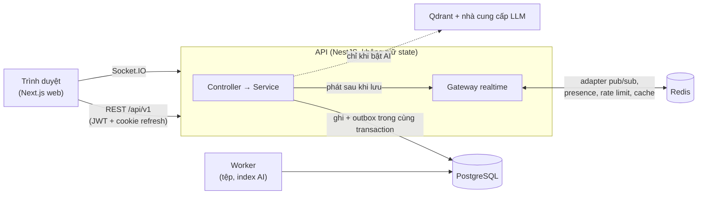

# Ping

Chat realtime tự dựng kiểu Discord: server, kênh, vai trò, tin nhắn, tệp, tìm kiếm và hỏi AI trên nội
dung của chính server đó. Chạy thật trên VPS công khai với Postgres/Redis thật, không phải bản demo
giao diện.

[](https://github.com/daithien2004/Ping/actions/workflows/ci.yml)

> **Bản chạy công khai:** https://20.193.75.48 — HTTPS (chứng chỉ IP Let's Encrypt, certbot tự gia hạn).
> Hai tài khoản demo quyền thấp: `demo1@ping.dev` và `demo2@ping.dev`; mật khẩu do OWNER gửi riêng,
> không nằm trong repo. Dữ liệu demo tạo hoàn toàn qua API công khai trên server "Ping Demo", không có dữ
> liệu người dùng thật ([cách tạo lại](docs/runbook/demo-data.md)).

|                  |   |
| --------------------------------------------------------------------- | ---------------------------------------------------- |
| Chat desktop, theme sáng — presence, unread, composer có tệp đính kèm | Cùng màn ở theme tối                                 |
|           |  |
| Tìm kiếm 375 px — bộ lọc kênh/người/thời gian                         | Cài đặt server: vai trò, mã mời, danh mục kênh       |

Ảnh lấy từ bộ baseline visual trong CI, dữ liệu seed, không có dữ liệu người dùng thật.

## Thử trong 2 phút

1. Mở https://20.193.75.48, đăng nhập `demo1@ping.dev`, vào server **Ping Demo › #general**.
2. Mở một cửa sổ ẩn danh với `demo2@ping.dev`, gõ tin ở hai bên — tin hiện ngay, kèm reply và reaction.
3. `Ctrl/⌘+K` để tìm trong server, đính kèm một ảnh, rồi đổi theme Sáng/Tối và ngôn ngữ vi/en trong Cài
   đặt cá nhân. Nút **Hỏi** trên bản công khai báo tạm không khả dụng vì chưa cấu hình khoá LLM; chạy
   local có khoá thì nó trả lời kèm trích dẫn.

## Làm được gì

- **Trò chuyện:** tin nhắn realtime, reply, reaction, ghim, sửa/xoá, trạng thái đã đọc đồng bộ nhiều
  thiết bị, thông báo và mention. Markdown tự viết parser với AST allowlist, không render HTML thô.
- **Tệp đính kèm:** ảnh/PDF qua pipeline kiểm magic bytes và reencode; URL tệp có chữ ký hạn 24 giờ và
  vẫn kiểm quyền mỗi lần tải.
- **Tổ chức:** server, kênh và danh mục kênh, vai trò tuỳ biến theo quyền, kick/ban, audit log, mã mời có
  hạn dùng và tái tạo được.
- **Tìm và nhắn riêng:** tìm kiếm full-text trong server theo quyền, lọc theo kênh/người/thời gian; DM
  1:1 có chặn người dùng.
- **Hỏi AI:** hỏi trên nội dung server, câu trả lời phải kèm trích dẫn tin có thật — không có trích dẫn
  hợp lệ thì không phát câu trả lời.
- **Giao diện:** responsive 375/768/1280, theme sáng/tối, tiếng Việt/tiếng Anh, đổi là áp dụng ngay.

Ngoài phạm vi v0.2.0: voice/video, mã hoá đầu cuối, S3, đa server hạ tầng, mobile native
([ADR-0038](docs/adr/0038-release-scope-v0.2.0.md)).

## Ba chỗ khó, và cách xử lý

- **Không mất, không lặp tin khi mất mạng.** Tin được ghi vào Postgres cùng một outbox trong đúng
  transaction; client phát hiện khoảng trống lúc reconnect rồi tải bù bằng con trỏ `after=<messageId>`,
  gửi lại theo `nonce` nên không nhân đôi.
- **Quyền không rò rỉ qua bất kỳ route nào.** Mọi truy vấn lọc theo membership: server lạ trả 403, id của
  server lạ hoặc DM của người khác trả 404, body không chứa dữ liệu của chủ sở hữu. 61 route có kịch bản
  IDOR riêng.
- **LLM là dependency không tin cậy.** Mọi UUID trong câu trả lời phải thuộc ngữ cảnh đã hydrate từ
  Postgres; thiếu trích dẫn hợp lệ thì hệ thống từ chối trả lời thay vì bịa.

Ba điểm này được kiểm bằng e2e trên Postgres/Redis thật, không phải bằng mock — bằng chứng từng hạng
mục ở [cổng nghiệm thu](docs/v0.2.0/acceptance/v0.2.0.md) và
[case study](docs/v0.2.0/case-studies/README.md).

## Giới hạn đã biết

- **Không có staging riêng.** https://20.193.75.48 là môi trường thật duy nhất; rollback, backup và load
  test đều diễn tập trên đó, có bước lùi và cửa sổ thời gian cụ thể.
- **AI, GIF, Sentry và email chưa bật hết.** Thiếu khoá LLM thì nút Hỏi trả `AI_UNAVAILABLE`; thiếu khoá
  Tenor thì tab GIF trả 503; chưa có project Sentry thật; chưa có mailer nên luồng xác minh email không
  áp dụng ([evidence](docs/v0.2.0/evidence/V2-final/flows-prod.md)).
- **Cuộn 10.000 tin còn long task > 50 ms** (max/p95 137 ms) do antd Avatar đọc layout mỗi lần mount;
  ghi `không đạt` trong nghiệm thu và nợ kỹ thuật P2 ([F14](docs/v0.2.0/evidence/V2-final/F14-scroll.md)).
- **Chưa có pilot người thật.** Load test production mới ở profile nhỏ đo từ máy OWNER: REST 10 vòng/giây
  (p95 1,28 s) và 100 socket, không 5xx; chưa chứng minh trần VPS vì máy bắn tải hết chỗ trước
  ([V9](docs/v0.2.0/evidence/V2-final/V9-load.md), [perf](docs/perf/2026-11-14-vps.md)).
- **Backup chưa phải PITR** và cron không dừng API/worker, nên snapshot không nhất quán tuyệt đối; RTO
  ~4,5 giây đo trên dữ liệu nhỏ nên không đại diện
  ([backup-restore](docs/runbook/backup-restore.md)).

## Chạy local trong ~15 phút

Cần **Node 24.22.0** (xem `.nvmrc`), **pnpm 10.26.0** (`corepack enable`) và **Docker** đang chạy.

```bash
git clone https://github.com/daithien2004/Ping.git
cd Ping
pnpm bootstrap     # cài dependency, tạo .env, bật Postgres + Redis, migrate, seed
pnpm dev           # web http://localhost:3000, API http://localhost:4000
```

`pnpm bootstrap` chạy lại bao nhiêu lần cũng được, giữ `.env` đang có. Đừng dùng `pnpm setup`: đó là lệnh
sẵn có của pnpm (cấu hình PATH), không phải script của dự án.

Đăng nhập bằng tài khoản seed (mật khẩu `password123`): `alice@ping.dev`, `bob@ping.dev`,
`carol@ping.dev` — cả ba đã ở trong server "Ping Playground". Mở hai trình duyệt để thấy realtime.

Muốn dữ liệu dày hơn (tìm kiếm, phân trang, badge unread): `pnpm seed:demo` — 3 server, 9 kênh, 21.600
tin tiếng Việt, 360 mention cho alice, kèm `david@ping.dev`. Trước buổi demo 5 phút thì dùng DB riêng:
`pnpm demo:prepare` (`--fresh` để xoá và tạo lại) — lệnh cụ thể ở [kịch bản demo](docs/v0.2.0/demo.md).

Hai phần tuỳ chọn, không cần để chat chạy:

| Muốn thử                        | Làm gì                                                                                                                                |
| ------------------------------- | ------------------------------------------------------------------------------------------------------------------------------------- |
| Tệp đính kèm (xử lý ảnh/PDF)    | Chạy thêm `pnpm --filter api dev:worker` — `pnpm dev` chỉ bật web + API, worker là tiến trình riêng                                   |
| Hỏi AI                          | Điền `GROQ_API_KEY` và `QDRANT_URL` trong `.env` rồi chạy `pnpm --filter api ai:backfill`; thiếu key thì nút Hỏi trả `AI_UNAVAILABLE` |
| Email xác minh/đặt lại mật khẩu | Điền `SMTP_URL` (ví dụ Mailpit `smtp://localhost:1025`); bỏ trống thì mail ghi ra console                                             |

Tài liệu API (Swagger) ở http://localhost:4000/docs khi không chạy production.

### Nếu không chạy được

| Triệu chứng                                 | Cách xử lý                                                                               |
| ------------------------------------------- | ---------------------------------------------------------------------------------------- |
| "Cần Node 24.22.0"                          | `nvm install 24.22.0 && nvm use 24.22.0` (nvm-windows: cùng lệnh), rồi chạy lại          |
| "Docker chưa chạy"                          | Bật Docker Desktop, đợi nó sẵn sàng, chạy lại `pnpm bootstrap`                           |
| Cổng 5432, 6379, 3000 hoặc 4000 đã bị chiếm | Tắt dịch vụ đang chiếm cổng (ví dụ Postgres cài sẵn trên máy) hoặc đổi cổng trong `.env` |
| Đã bootstrap nhưng web báo lỗi mạng         | API chưa chạy: kiểm tra http://localhost:4000/api/v1/health                              |
| Gửi tệp xong nhưng không gửi được tin       | Worker chưa chạy: `pnpm --filter api dev:worker`                                         |
| Muốn xóa sạch dữ liệu dev                   | `docker compose down -v` rồi `pnpm bootstrap`                                            |

## Bên trong



Ghi dữ liệu qua REST vào Postgres (kèm outbox trong cùng transaction), rồi mới phát realtime qua
gateway. Redis chỉ giữ pub/sub, cache quyền 30 giây và bộ đếm giới hạn tốc độ, nên nhiều instance API
chạy song song và Redis chết thì REST vẫn phục vụ
([ADR-0026](docs/adr/0026-failure-modes-and-graceful-shutdown.md)). Qdrant và LLM là thành phần tuỳ
chọn. Chi tiết: [docs/architecture.md](docs/architecture.md).

| Phần            | Công nghệ                                                | Vì sao chọn                                                                                                              |
| --------------- | -------------------------------------------------------- | ------------------------------------------------------------------------------------------------------------------------ |
| `apps/api`      | NestJS 12 (ESM), Prisma 7, PostgreSQL 17                 | Module hoá theo miền; migration expand/contract và type của schema                                                       |
| Realtime        | Socket.IO 4 + adapter Redis                              | Room theo channel, tự reconnect, chạy nhiều instance sau load balancer                                                   |
| Quyền           | CASL 7 trong `@ping/shared`                              | Một định nghĩa ability dùng cho cả API (guard) và web (ẩn/hiện nút)                                                      |
| Hàng đợi nội bộ | Bảng outbox + worker claim trong Postgres                | Không thêm broker; giao at-least-once, client idempotent theo `nonce`                                                    |
| `apps/web`      | Next.js 16.4 (App Router), React 19                      | Route theo đoạn, stream, tách chunk theo màn                                                                             |
| UI              | antd 6.6 bọc trong 33 component `Ping*`, token một nguồn | API riêng của dự án; lint cấm import `antd` ngoài `components/ui/` ([ADR-0050](docs/adr/0050-antd-via-ping-wrappers.md)) |
| Trạng thái      | TanStack Query 5 (server) + Zustand 5 (UI)               | Không copy dữ liệu server vào store                                                                                      |
| i18n            | use-intl 4, vi/en                                        | 668 khoá mỗi ngôn ngữ, parity có unit test                                                                               |
| Hợp đồng        | `@ping/shared`: zod 4, event name, mã lỗi, trần số lượng | API và web không tự định nghĩa lại ([ADR-0002](docs/adr/0002-shared-contracts.md))                                       |
| Kiểm thử        | Vitest, Playwright 1.63, axe, Lighthouse                 | E2E trên DB thật; visual regression; a11y là cổng chứ không phải phụ lục                                                 |

**Kiểm bằng gì:** CI có 6 check bắt buộc (`verify`, `api-e2e`, `web-e2e-gate`, `visual`, `migrations`,
`security`); 36 baseline visual mỗi hệ điều hành (6 màn × 2 theme × 3 viewport); axe không còn vi phạm
nào theo WCAG 2.1 A/AA. Mỗi task có thư mục evidence riêng trong [docs](docs/README.md).

```
apps/api/            NestJS: src/modules/<miền>/, prisma/ (schema, migration, seed), test/
apps/web/            Next.js: src/{app, features/<miền>, components, lib}, e2e/, visual/
packages/shared/     @ping/shared: hợp đồng giữa API và web
docs/                architecture, adr/ (68 quyết định), runbook/, v0.2.0/ (kế hoạch, bằng chứng, case study)
ops/                 cấu hình Nginx, quy tắc cảnh báo Prometheus
tools/loadtest/      kịch bản k6 (xem docs/perf/README.md)
```

### Lệnh thường dùng

| Việc                 | Lệnh                                                                           |
| -------------------- | ------------------------------------------------------------------------------ |
| Chạy dev (web + API) | `pnpm dev` (worker: `pnpm --filter api dev:worker`)                            |
| Build                | `pnpm build`                                                                   |
| Lint / typecheck     | `pnpm lint` / `pnpm typecheck`                                                 |
| Test đơn vị          | `pnpm test`                                                                    |
| E2E API (cần Docker) | `pnpm --filter api test:e2e`                                                   |
| E2E web (cần Docker) | `pnpm --filter web test:e2e` (tự bật API và web, dùng lại nếu đang chạy)       |
| Visual regression    | `pnpm --filter web test:visual` (baseline: `test:visual:update`)               |
| Định dạng            | `pnpm format` (ghi) / `pnpm format:check`                                      |
| Migration mới        | `pnpm db:migrate` (đọc [runbook/migrations](docs/runbook/migrations.md) trước) |
| Xem DB               | `pnpm db:studio`                                                               |
| Ngân sách bundle web | `pnpm --filter web check:bundle` (sau `pnpm build`)                            |

Lần đầu chạy E2E/visual trên máy mới cần trình duyệt Playwright:
`pnpm --filter web exec playwright install chromium`. Quy trình đầy đủ:
[CONTRIBUTING.md](CONTRIBUTING.md) và [CLAUDE.md](CLAUDE.md).

## Triển khai

Production là **một VPS Azure nhỏ** (2 vCPU, ~4 GB RAM) chạy Docker Compose: Nginx TLS, web, api,
worker, Postgres 17, Redis 7. Image lên GHCR và pin theo SHA; deploy/rollback bằng workflow
`workflow_dispatch`, mỗi chiều ~40 giây với smoke test sau đó
([runbook](docs/runbook/ci-cd-vps.md), [ADR-0083](docs/adr/0083-ghcr-and-github-actions-vps-deployment.md),
[evidence rollback](docs/v0.2.0/evidence/V2-final/V4-rollback.md)). Chứng chỉ IP Let's Encrypt gia hạn
tự động bằng certbot, đã kiểm bằng `renew --dry-run`. Backup chạy cron 02:30 UTC, mã hoá `age` trước khi
rời máy, giữ 14 ngày, restore đã diễn tập
([V5](docs/v0.2.0/evidence/V2-final/V5-backup.md)). Vẫn **không có staging riêng** — mọi diễn tập chạy
trên production.

Chi phí: không S3, không Sentry, không domain; AI chạy free tier và tự tắt khi thiếu key. Trần thiết kế
20 USD/tháng ([ADR-0038](docs/adr/0038-release-scope-v0.2.0.md)); chưa có bảng giá từng dòng nên chưa
tuyên bố "đã vận hành dưới 20 USD" ([case 6](docs/v0.2.0/case-studies/cs-06-ops-under-20usd.md)).

Đang chốt `v0.2.0`: trạng thái từng hạng mục ở [nghiệm thu](docs/v0.2.0/acceptance/v0.2.0.md), tag chờ
OWNER duyệt. Tiến độ và phần còn mở: [status.md](docs/v0.2.0/status.md).

## Tài liệu

- **Mục lục và cách đọc:** [docs/README.md](docs/README.md).
- **Case study (9 bài, có số đo và giới hạn):** [docs/v0.2.0/case-studies](docs/v0.2.0/case-studies/README.md).
- **Xem sản phẩm chạy:** [kịch bản demo 5 phút](docs/v0.2.0/demo.md); **hỏi đáp phỏng vấn (45 câu):**
  [interview-qa.md](docs/v0.2.0/interview-qa.md).
- **Tiến độ phát hành:** [trạng thái v0.2.0](docs/v0.2.0/status.md),
  [nghiệm thu v0.1.0](docs/acceptance/v0.1.0.md), [nợ kỹ thuật](docs/tech-debt.md),
  [hướng dẫn tự review](docs/review/reading-guide.md).
- **Kiến trúc:** [docs/architecture.md](docs/architecture.md) và các [ADR](docs/adr/).
- **Thiết kế:** [hướng thiết kế](docs/design/direction.md), [quy ước trạng thái](docs/design/states.md).
- **Vận hành:** [docs/runbook/](docs/runbook/README.md) — tra lỗi bằng `requestId`, migration, backup,
  rollback, sự cố hạ tầng, cảnh báo.
- **Kỹ thuật khác:** [API](docs/api-conventions.md), [bảo mật](docs/security/threat-model.md),
  [hiệu năng](docs/perf/README.md), [Web Vitals và bundle](docs/v0.2.0/evidence/TF.15/README.md).

## Phiên bản công cụ

Node và pnpm được ghim theo `package.json` (`engines`, `packageManager`) và `.nvmrc`; mọi dependency ghim
phiên bản chính xác ([chính sách](docs/adr/0001-dependency-versions.md)). Commit `pnpm-lock.yaml` cùng
mọi thay đổi dependency.
