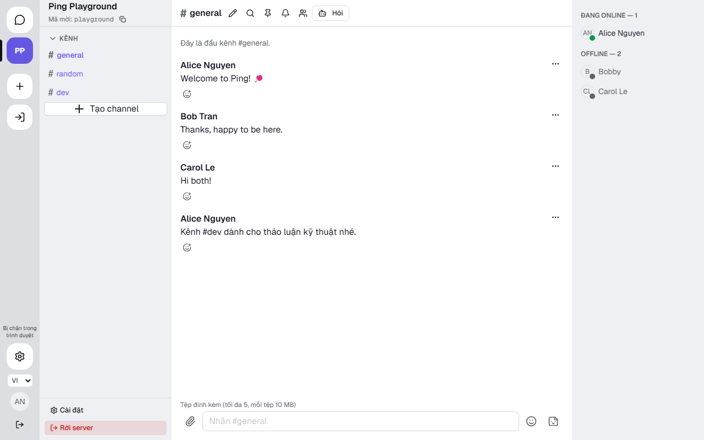
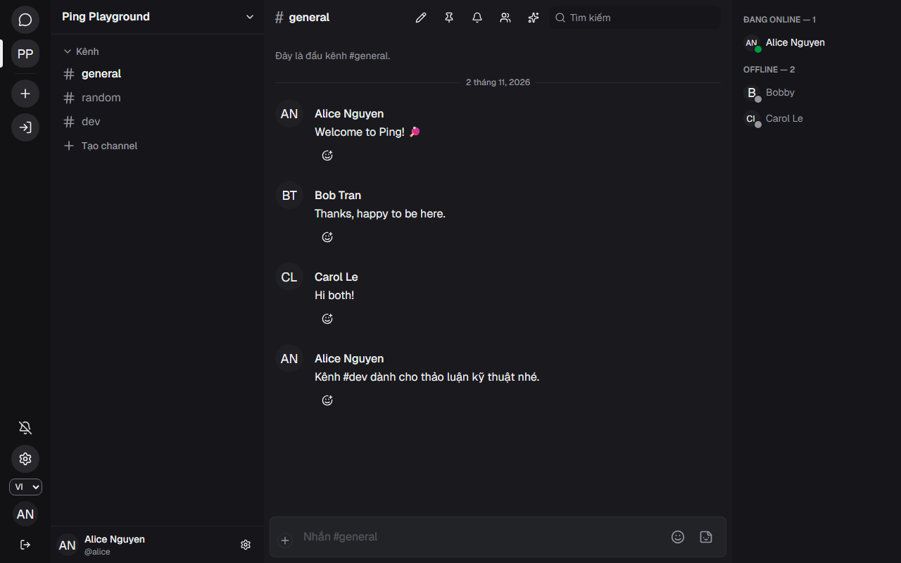
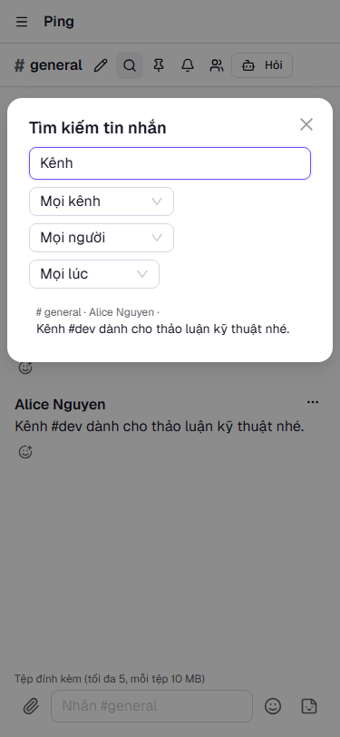
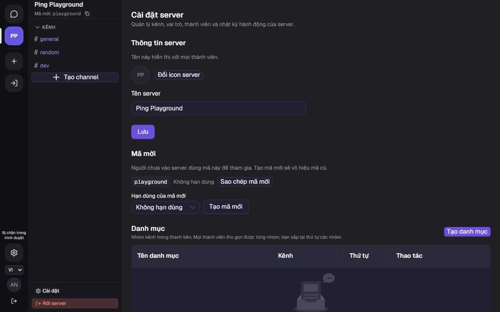
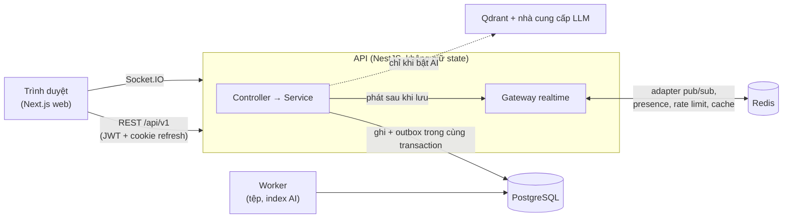

# Ping

Ứng dụng chat realtime kiểu Discord tự dựng: server, channel, tin nhắn, vai trò và quyền, trạng thái online.
Monorepo pnpm + Turborepo. `v0.2.0` thêm DM, tìm kiếm, tệp đính kèm, Markdown an toàn, hỏi AI và giao diện hai
ngôn ngữ, hai theme.

[](https://github.com/daithien2004/Ping/actions/workflows/ci.yml)

> **Trạng thái 2026-11-01 — bản demo local.** Mọi hạng mục `v0.2.0` không cần hạ tầng trả phí đã xong và merge
> `main`; OWNER chốt dừng ở mức demo nên **chưa tag `v0.2.0`**. Phần vận hành (staging, HTTPS, backup/restore,
> Sentry, load test ngoài máy) làm khi có kinh phí, lúc đó mới đóng cổng nghiệm thu và tag. Xem
> [trạng thái](docs/v0.2.0/status.md#chốt-bản-demo-2026-11-01) và
> [nghiệm thu](docs/v0.2.0/acceptance/v0.2.0.md).

## Tóm tắt trong 60 giây

- **Đây là gì:** một sản phẩm chat chạy được, không phải bản demo giao diện — đăng ký, server/kênh, phân quyền
  theo vai trò, tin nhắn realtime, reply, reaction, ghim, tệp, tìm kiếm, DM, thông báo, kiểm duyệt, hỏi AI trên
  nội dung server.
- **Ba chỗ khó được xử lý nghiêm túc:** tin nhắn **không mất và không lặp** khi mất mạng (outbox trong Postgres
  cùng transaction với tin; client phát hiện khoảng trống khi reconnect và tải bù bằng con trỏ
  `after=<messageId>`); **quyền không rò rỉ** qua bất kỳ route nào (mọi truy vấn lọc theo membership; server
  lạ trả 403, id của server lạ hoặc DM của người khác trả 404, body không chứa dữ liệu của chủ sở hữu);
  **LLM là dependency không tin cậy** (mọi UUID trong câu trả lời phải
  thuộc ngữ cảnh đã hydrate từ Postgres, nếu không thì không phát).
- **Kiểm bằng gì:** CI gồm 6 check bắt buộc (`verify`, `api-e2e`, `web-e2e-gate`, `visual`, `migrations`,
  `security`); e2e chạy trên Postgres/Redis thật; 61 endpoint có kịch bản IDOR; 36 baseline visual (6 màn × 2
  theme × 3 viewport); axe không còn vi phạm nào theo WCAG 2.1 A/AA. Mỗi task có thư mục evidence riêng.
- **Chi phí:** 0 USD. Không S3, không hạ tầng trả phí, AI chạy free tier và tự tắt khi thiếu key. Trần thiết kế
  là 20 USD/tháng ([ADR-0038](docs/adr/0038-release-scope-v0.2.0.md)), xem [case 6](docs/v0.2.0/case-studies/cs-06-ops-under-20usd.md).
- **Chưa có gì:** bản chạy công khai/staging, load test ngoài laptop, quét virus tệp, RPO/RTO thật. Những ô này
  ghi "chưa đo" ở [nghiệm thu v0.2.0](docs/v0.2.0/acceptance/v0.2.0.md) thay vì điền số ước lượng.

|                  |   |
| --------------------------------------------------------------------- | ---------------------------------------------------- |
| Chat desktop, theme sáng — presence, unread, composer có tệp đính kèm | Cùng màn ở theme tối                                 |
|           |  |
| Tìm kiếm 375 px — bộ lọc kênh/người/thời gian                         | Cài đặt server: vai trò, mã mời, danh mục kênh       |

Ảnh lấy từ bộ baseline visual trong CI ([TF.13](docs/v0.2.0/evidence/TF.13/README.md)), dữ liệu seed, không có
dữ liệu người dùng thật.

## Kiến trúc trong một hình



Ghi dữ liệu qua REST vào Postgres (kèm outbox trong cùng transaction), rồi mới phát realtime qua gateway. Redis
chỉ giữ pub/sub, cache quyền 30 giây và bộ đếm giới hạn tốc độ, nên nhiều instance API chạy song song và Redis
chết thì REST vẫn phục vụ ([ADR-0026](docs/adr/0026-failure-modes-and-graceful-shutdown.md)). Qdrant và LLM là
thành phần tuỳ chọn: không cấu hình thì nút "Hỏi" trả `AI_UNAVAILABLE`, phần chat không ảnh hưởng. Chi tiết và
hình đầy đủ: [docs/architecture.md](docs/architecture.md).

## Công nghệ và lý do

| Phần            | Công nghệ                                                | Vì sao chọn                                                                                                                                                                                                             |
| --------------- | -------------------------------------------------------- | ----------------------------------------------------------------------------------------------------------------------------------------------------------------------------------------------------------------------- |
| `apps/api`      | NestJS 12 (ESM), Prisma 7, PostgreSQL 17                 | Module hoá theo miền, DI rõ ràng; Prisma giữ migration expand/contract và type của schema                                                                                                                               |
| Realtime        | Socket.IO 4 + adapter Redis                              | Room theo channel, tự reconnect, chạy nhiều instance sau load balancer                                                                                                                                                  |
| Quyền           | CASL 7 trong `@ping/shared`                              | Một định nghĩa ability dùng cho cả API (guard) và web (ẩn/hiện nút), không chép lại luật                                                                                                                                |
| Hàng đợi nội bộ | Bảng outbox + worker claim trong Postgres                | Không thêm broker; giao at-least-once, client idempotent theo `nonce`                                                                                                                                                   |
| `apps/web`      | Next.js 16.4 (App Router), React 19                      | Route theo đoạn, stream, tách chunk theo màn                                                                                                                                                                            |
| UI              | antd 6.6 bọc trong 33 component `Ping*`, token một nguồn | API riêng của dự án, đổi ruột một component không phải sửa nơi dùng; lint cấm import `antd` ngoài `components/ui/` ([ADR-0050](docs/adr/0050-antd-via-ping-wrappers.md), [ADR-0051](docs/adr/0051-design-direction.md)) |
| Trạng thái      | TanStack Query 5 (server) + Zustand 5 (UI)               | Không copy dữ liệu server vào store; cache theo khoá rõ ràng                                                                                                                                                            |
| i18n            | use-intl 4, vi/en                                        | 668 khoá mỗi ngôn ngữ, parity có unit test; đổi ngôn ngữ không reload                                                                                                                                                   |
| Hợp đồng        | `@ping/shared`: zod 4, event name, mã lỗi, trần số lượng | API và web không tự định nghĩa lại ([ADR-0002](docs/adr/0002-shared-contracts.md))                                                                                                                                      |
| Kiểm thử        | Vitest, Playwright 1.63, axe, Lighthouse                 | E2E trên DB thật; visual regression; a11y là cổng chứ không phải phụ lục                                                                                                                                                |

Bản `v0.1.0` dùng shadcn/Radix; từ `v0.2.0` bảng/form quản trị nhiều nên đổi sang antd sau wrapper
([ADR-0023](docs/adr/0023-web-ui-kit-and-tokens.md) vẫn giữ phần token, xem [case 8](docs/v0.2.0/case-studies/cs-08-frontend-design-system.md)).

## v0.2.0 có gì

Chat và quyền: server/kênh/danh mục kênh, vai trò tuỳ biến, kick/ban, audit log, mã mời có hạn dùng. Tin nhắn:
reply, reaction, ghim, chỉnh sửa/xoá, Markdown tự viết parser với AST allowlist (không `dangerouslySetInnerHTML`),
tệp đính kèm qua pipeline kiểm magic bytes + reencode. Khác: DM 1:1 có chặn người dùng, tìm kiếm FTS theo quyền,
thông báo và email, trạng thái đã đọc đa thiết bị, hỏi AI có trích dẫn. Giao diện: responsive 375/768/1280, theme
sáng/tối, vi/en.

Ngoài phạm vi lần này: voice/video, mã hoá đầu cuối, S3, đa server hạ tầng, mobile native
([ADR-0038](docs/adr/0038-release-scope-v0.2.0.md)). Trạng thái từng task:
[docs/v0.2.0/status.md](docs/v0.2.0/status.md).

## Chạy local trong ~15 phút

Cần: **Node 24.22.0** (xem `.nvmrc`), **pnpm 10.26.0** (`corepack enable`), **Docker** đang chạy.

```bash
git clone https://github.com/daithien2004/Ping.git
cd Ping
pnpm bootstrap     # cài dependency, tạo .env, bật Postgres + Redis, migrate, seed
pnpm dev           # web http://localhost:3000, API http://localhost:4000
```

`pnpm bootstrap` chạy lại bao nhiêu lần cũng được (giữ `.env` đang có). Không dùng `pnpm setup`: đó là lệnh có sẵn
của pnpm (cấu hình PATH), không phải script của dự án.

Đăng nhập thử bằng tài khoản seed (mật khẩu `password123`): `alice@ping.dev`, `bob@ping.dev`, `carol@ping.dev` — cả
ba đã ở trong server "Ping Playground". Mở hai trình duyệt (hoặc một cửa sổ ẩn danh) để thấy tin nhắn realtime.

Cần dữ liệu demo nhiều hơn (thử tìm kiếm, phân trang, badge unread): `pnpm seed:demo` — 3 server theo chủ đề
(qua bàn cà phê / nhóm lập trình / sở thích), 9 kênh, 21.600 tin tiếng Việt, 360 mention cho alice; tài khoản
`david@ping.dev` đi kèm. Chạy lại bao nhiêu lần cũng cho cùng dữ liệu (id và nội dung cố định).

Trước buổi diễn 5 phút, dùng DB riêng thay vì DB dev đã tích dữ liệu: `pnpm demo:prepare` bật Docker, tạo
`ping_demo`, migrate + seed và kiểm số liệu; thêm `--fresh` để xoá rồi tạo lại sạch. Ba process phải cùng trỏ
`DATABASE_URL` của DB đó — lệnh cụ thể ở [kịch bản demo](docs/v0.2.0/demo.md).

Hai phần tuỳ chọn, không cần để chat chạy:

| Muốn thử                        | Làm gì                                                                                                                                |
| ------------------------------- | ------------------------------------------------------------------------------------------------------------------------------------- |
| Tệp đính kèm (xử lý ảnh/PDF)    | Chạy thêm `pnpm --filter api dev:worker` — `pnpm dev` chỉ bật web + API, worker là tiến trình riêng                                   |
| Hỏi AI                          | Điền `GROQ_API_KEY` và `QDRANT_URL` trong `.env` rồi chạy `pnpm --filter api ai:backfill`; thiếu key thì nút Hỏi trả `AI_UNAVAILABLE` |
| Email xác minh/đặt lại mật khẩu | Điền `SMTP_URL` (ví dụ Mailpit `smtp://localhost:1025`); bỏ trống thì mail ghi ra console                                             |

Tài liệu API (Swagger) ở http://localhost:4000/docs khi không chạy production.

### Nếu không chạy được

| Triệu chứng                                 | Cách xử lý                                                                               |
| ------------------------------------------- | ---------------------------------------------------------------------------------------- |
| "Cần Node 24.22.0"                          | `nvm install 24.22.0 && nvm use 24.22.0` (nvm-windows: cùng lệnh), rồi chạy lại          |
| "Docker chưa chạy"                          | Bật Docker Desktop, đợi nó sẵn sàng, chạy lại `pnpm bootstrap`                           |
| Cổng 5432, 6379, 3000 hoặc 4000 đã bị chiếm | Tắt dịch vụ đang chiếm cổng (ví dụ Postgres cài sẵn trên máy) hoặc đổi cổng trong `.env` |
| Đã bootstrap nhưng web báo lỗi mạng         | API chưa chạy: kiểm tra http://localhost:4000/api/v1/health                              |
| Gửi tệp xong nhưng không gửi được tin       | Worker chưa chạy: `pnpm --filter api dev:worker`                                         |
| Muốn xóa sạch dữ liệu dev                   | `docker compose down -v` rồi `pnpm bootstrap`                                            |

## Lệnh thường dùng

| Việc                 | Lệnh                                                                           |
| -------------------- | ------------------------------------------------------------------------------ |
| Chạy dev (web + API) | `pnpm dev` (worker: `pnpm --filter api dev:worker`)                            |
| Chuẩn bị DB demo     | `pnpm demo:prepare` (`--fresh`: xoá và tạo lại `ping_demo`)                    |
| Build                | `pnpm build`                                                                   |
| Lint / typecheck     | `pnpm lint` / `pnpm typecheck`                                                 |
| Test đơn vị          | `pnpm test`                                                                    |
| E2E API (cần Docker) | `pnpm --filter api test:e2e`                                                   |
| E2E web (cần Docker) | `pnpm --filter web test:e2e` (tự bật API và web, dùng lại nếu đang chạy)       |
| Visual regression    | `pnpm --filter web test:visual` (baseline: `test:visual:update`)               |
| Định dạng            | `pnpm format` (ghi) / `pnpm format:check`                                      |
| Migration mới        | `pnpm db:migrate` (đọc [runbook/migrations](docs/runbook/migrations.md) trước) |
| Xem DB               | `pnpm db:studio`                                                               |
| Ngân sách bundle web | `pnpm --filter web check:bundle` (sau `pnpm build`)                            |
| Kiểm token/thiết kế  | `pnpm --filter web audit:design` — chạy được không cần build                   |

Lần đầu chạy E2E/visual trên máy mới cần trình duyệt của Playwright:
`pnpm --filter web exec playwright install chromium`.

## Cấu trúc thư mục

```
apps/api/            NestJS: src/modules/<miền>/{controller,service,module}, prisma/ (schema, migration, seed), test/
apps/web/            Next.js: src/{app (chỉ định tuyến), features/<miền>, components, lib}, e2e/ (Playwright), visual/
packages/shared/     @ping/shared: hợp đồng giữa API và web
docs/                architecture.md, adr/ (68 quyết định), runbook/, v0.2.0/ (kế hoạch, bằng chứng, case study)
ops/                 cấu hình Nginx, quy tắc cảnh báo Prometheus
tools/loadtest/      kịch bản k6 (xem docs/perf/README.md)
```

## Tài liệu

- **Mục lục và cách đọc:** [docs/README.md](docs/README.md).
- **Case study (9 bài, có số đo và giới hạn):** [docs/v0.2.0/case-studies](docs/v0.2.0/case-studies/README.md).
- **Xem sản phẩm chạy:** [kịch bản demo 5 phút](docs/v0.2.0/demo.md); **hỏi đáp phỏng vấn (45 câu):**
  [interview-qa.md](docs/v0.2.0/interview-qa.md).
- **Tiến độ phát hành:** [trạng thái v0.2.0](docs/v0.2.0/status.md),
  [nghiệm thu v0.2.0](docs/v0.2.0/acceptance/v0.2.0.md), [nghiệm thu v0.1.0](docs/acceptance/v0.1.0.md),
  [nợ kỹ thuật](docs/tech-debt.md), [hướng dẫn tự review](docs/review/reading-guide.md).
- **Bắt đầu đóng góp:** [CONTRIBUTING.md](CONTRIBUTING.md) — quy trình, kiểm tra trước khi mở PR, quy tắc bắt buộc ([CLAUDE.md](CLAUDE.md)).
- **Kiến trúc:** [docs/architecture.md](docs/architecture.md) và các [ADR](docs/adr/).
- **Thiết kế:** [hướng thiết kế](docs/design/direction.md), [quy ước trạng thái](docs/design/states.md).
- **Vận hành:** [docs/runbook/](docs/runbook/README.md) — tra lỗi bằng `requestId`, migration, backup, rollback, sự cố hạ tầng, cảnh báo.
- **API:** [docs/api-conventions.md](docs/api-conventions.md). **Bảo mật:** [docs/security/threat-model.md](docs/security/threat-model.md).
- **Hiệu năng:** [docs/perf/](docs/perf/README.md), [đo Web Vitals và bundle theo route](docs/v0.2.0/evidence/TF.15/README.md).

## Triển khai và giới hạn công khai

Có sẵn Dockerfile cho api và web, stack production mẫu (`docker-compose.prod.example.yml`: Nginx, api, web, Postgres,
Redis, migration chạy riêng), [cấu hình HTTP/HTTPS](ops/nginx/README.md) và CI
([ADR-0035](docs/adr/0035-nginx-reverse-proxy.md)).

Đã thêm workflow chuẩn bị CI/CD một VPS qua GHCR, SSH restricted command, bootstrap env/backup và rollback theo SHA
([runbook](docs/runbook/ci-cd-vps.md), [ADR-0083](docs/adr/0083-ghcr-and-github-actions-vps-deployment.md)). Bootstrap và cấp chứng chỉ IP đã chạy trên VPS; deploy app và gia hạn tự động chưa được xác minh end-to-end.

**Chưa có bản chạy công khai.** `v0.1.0` nghiệm thu **local-only**: deploy/backup/restore diễn tập trên Docker
local ([ADR-0036](docs/adr/0036-local-deployment.md)); `v0.2.0` hoãn hạ tầng trả phí
([ADR-0059](docs/adr/0059-defer-paid-infrastructure.md)) nên không có link staging. Mọi số hiệu năng là đo lab
trên một laptop, không phải SLA. Kế hoạch và phần còn thiếu:
[docs/v0.2.0/plan.md](docs/v0.2.0/plan.md), [trạng thái](docs/v0.2.0/status.md).

## Phiên bản công cụ

Node và pnpm được ghim theo `package.json` (`engines`, `packageManager`) và `.nvmrc`; mọi dependency ghim phiên bản
chính xác ([chính sách](docs/adr/0001-dependency-versions.md)). Commit `pnpm-lock.yaml` cùng mọi thay đổi dependency.
