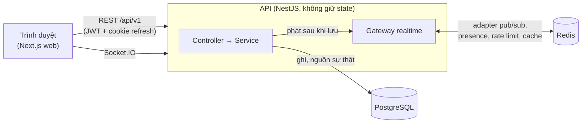

# Ping

Ứng dụng chat realtime kiểu Discord: server, channel, tin nhắn, vai trò và quyền, trạng thái online. Monorepo
pnpm + Turborepo.

[](https://github.com/daithien2004/Ping/actions/workflows/ci.yml)

| Phần                | Công nghệ                                                                         |
| ------------------- | --------------------------------------------------------------------------------- |
| `apps/api`          | NestJS 12 (ESM), PostgreSQL + Prisma 7, Redis, Socket.IO                          |
| `apps/web`          | Next.js 16, React 19, TanStack Query, Zustand, shadcn/ui, use-intl                |
| `packages/shared`   | `@ping/shared`: schema zod, quyền (CASL), tên event socket, mã lỗi, trần số lượng |
| `packages/*config*` | cấu hình TypeScript và ESLint dùng chung                                          |

## Kiến trúc trong một hình



Ghi dữ liệu qua REST vào Postgres, rồi mới phát realtime qua gateway; Redis chỉ giữ pub/sub, cache và bộ đếm giới hạn
tốc độ, nên nhiều instance API chạy song song và Redis chết thì REST vẫn chạy. Chi tiết: [docs/architecture.md](docs/architecture.md).

## Chạy local trong ~15 phút

Cần: **Node 24.22.0** (xem `.nvmrc`), **pnpm 10.26.0** (`corepack enable`), **Docker** đang chạy.

```bash
git clone https://github.com/daithien2004/Ping.git
cd Ping
pnpm bootstrap     # cài dependency, tạo .env, bật Postgres + Redis, migrate, seed
pnpm dev           # web http://localhost:3000, API http://localhost:4000
```

`pnpm bootstrap` chạy lại bao nhiêu lần cũng được (giữ `.env` đang có). Không dùng `pnpm setup`: đó là lệnh có sẵn
của pnpm (cấu hình PATH), không phải script của dự án.

Đăng nhập thử bằng tài khoản seed (mật khẩu `password123`): `alice@ping.dev`, `bob@ping.dev`, `carol@ping.dev` — cả
ba đã ở trong server "Ping Playground". Mở hai trình duyệt (hoặc một cửa sổ ẩn danh) để thấy tin nhắn realtime.

Tài liệu API (Swagger) ở http://localhost:4000/docs khi không chạy production.

### Nếu không chạy được

| Triệu chứng                                 | Cách xử lý                                                                               |
| ------------------------------------------- | ---------------------------------------------------------------------------------------- |
| "Cần Node 24.22.0"                          | `nvm install 24.22.0 && nvm use 24.22.0` (nvm-windows: cùng lệnh), rồi chạy lại          |
| "Docker chưa chạy"                          | Bật Docker Desktop, đợi nó sẵn sàng, chạy lại `pnpm bootstrap`                           |
| Cổng 5432, 6379, 3000 hoặc 4000 đã bị chiếm | Tắt dịch vụ đang chiếm cổng (ví dụ Postgres cài sẵn trên máy) hoặc đổi cổng trong `.env` |
| Đã bootstrap nhưng web báo lỗi mạng         | API chưa chạy: kiểm tra http://localhost:4000/api/v1/health                              |
| Muốn xóa sạch dữ liệu dev                   | `docker compose down -v` rồi `pnpm bootstrap`                                            |

## Lệnh thường dùng

| Việc                 | Lệnh                                                                           |
| -------------------- | ------------------------------------------------------------------------------ |
| Chạy dev (web + API) | `pnpm dev`                                                                     |
| Build                | `pnpm build`                                                                   |
| Lint / typecheck     | `pnpm lint` / `pnpm typecheck`                                                 |
| Test đơn vị          | `pnpm test`                                                                    |
| E2E API (cần Docker) | `pnpm --filter api test:e2e`                                                   |
| E2E web (cần Docker) | `pnpm --filter web test:e2e` (tự bật API và web, dùng lại nếu đang chạy)       |
| Định dạng            | `pnpm format` (ghi) / `pnpm format:check`                                      |
| Migration mới        | `pnpm db:migrate` (đọc [runbook/migrations](docs/runbook/migrations.md) trước) |
| Xem DB               | `pnpm db:studio`                                                               |
| Ngân sách bundle web | `pnpm --filter web check:bundle` (sau `pnpm build`)                            |

Lần đầu chạy E2E web trên máy mới cần trình duyệt của Playwright: `pnpm --filter web exec playwright install chromium`.

## Cấu trúc thư mục

```
apps/api/            NestJS: src/modules/<miền>/{controller,service,module}, prisma/ (schema, migration, seed), test/
apps/web/            Next.js: src/{app (chỉ định tuyến), features/<miền>, components, lib}, e2e/ (Playwright)
packages/shared/     @ping/shared: hợp đồng giữa API và web
docs/                architecture.md, adr/ (33+ quyết định), runbook/, perf/, security/, api-conventions.md
ops/                 cấu hình Nginx, quy tắc cảnh báo Prometheus
tools/loadtest/      kịch bản k6 (xem docs/perf/README.md)
```

## Tài liệu

- **Mục lục và cách đọc:** [docs/README.md](docs/README.md).
- **Tiến độ phát hành:** [nghiệm thu v0.1.0](docs/acceptance/v0.1.0.md), [nợ kỹ thuật](docs/tech-debt.md), [hướng dẫn tự review](docs/review/reading-guide.md).
- **Bắt đầu đóng góp:** [CONTRIBUTING.md](CONTRIBUTING.md) — quy trình, kiểm tra trước khi mở PR, quy tắc bắt buộc ([CLAUDE.md](CLAUDE.md)).
- **Kiến trúc:** [docs/architecture.md](docs/architecture.md) và các [ADR](docs/adr/).
- **Vận hành:** [docs/runbook/](docs/runbook/README.md) — tra lỗi bằng `requestId`, migration, backup, rollback, sự cố hạ tầng, cảnh báo.
- **API:** [docs/api-conventions.md](docs/api-conventions.md). **Bảo mật:** [docs/security/threat-model.md](docs/security/threat-model.md).
- **Hiệu năng:** [docs/perf/](docs/perf/README.md).

## Triển khai

Có sẵn Dockerfile cho api và web, stack production mẫu (`docker-compose.prod.example.yml`: Nginx, api, web, Postgres,
Redis, migration chạy riêng), [cấu hình HTTP/HTTPS](ops/nginx/README.md) và CI
([ADR-0035](docs/adr/0035-nginx-reverse-proxy.md)). Chọn nơi chạy cụ thể và runbook
triển khai sẽ làm trước phiên bản `v0.1.0`.

## Phiên bản công cụ

Node và pnpm được ghim theo `package.json` (`engines`, `packageManager`) và `.nvmrc`; mọi dependency ghim phiên bản
chính xác ([chính sách](docs/adr/0001-dependency-versions.md)). Commit `pnpm-lock.yaml` cùng mọi thay đổi dependency.
