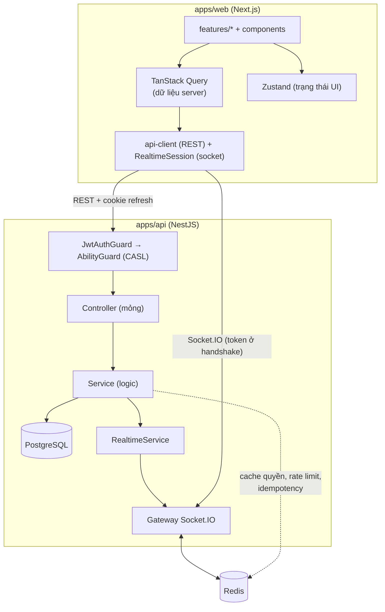
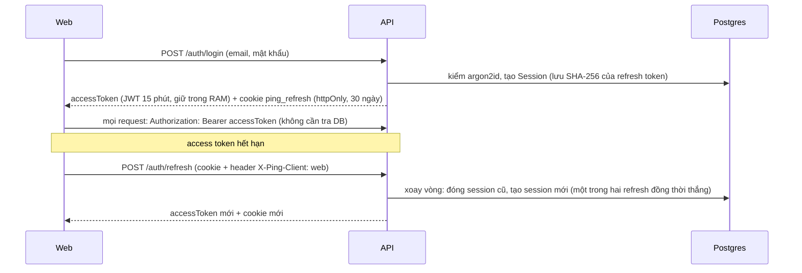
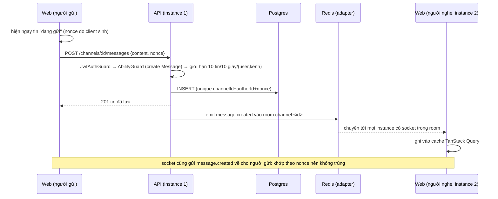

# Kiến trúc

Viết từ code hiện có; mỗi mục dẫn tới ADR ghi lý do. Hình tổng quan ở [README](../README.md).

## 1. Nguyên tắc nền

1. **API không giữ state trong RAM.** Mọi instance như nhau; nhiều instance chạy sau một load balancer.
2. **Postgres là nguồn sự thật.** Redis chỉ giữ pub/sub (adapter Socket.IO), cache quyền 30 giây, bộ đếm rate limit và
   khóa idempotency. Redis chết thì REST và lưu tin vẫn chạy ([ADR-0026](adr/0026-failure-modes-and-graceful-shutdown.md)).
3. **Ghi qua REST, phát realtime sau khi đã lưu.** Socket không ghi dữ liệu (trừ `typing`); client gửi tin bằng REST.
4. **Hợp đồng dùng chung ở `@ping/shared`:** schema zod, quyền, tên event, mã lỗi, trần số lượng. API và web không tự
   định nghĩa lại ([ADR-0002](adr/0002-shared-contracts.md)).

## 2. Các thành phần

Backend theo lớp `Guard → Controller → Service → Prisma`; controller chỉ parse request và gọi service. Frontend theo
`app → features → components → lib` (ESLint chặn chiều ngược).

## 3. Xác thực ([ADR-0007](adr/0007-auth-token-model.md), [ADR-0027](adr/0027-web-and-api-hardening.md))

- Refresh token là chuỗi ngẫu nhiên đục, đã xoay vòng; dùng lại token cũ sau 10 giây bị coi là bị đánh cắp và thu hồi
  mọi phiên của user.
- `/auth/refresh` và `/auth/logout` dùng cookie nên có `CsrfGuard` (header `X-Ping-Client`, kiểm `Origin`).
- Đăng nhập chống dò mật khẩu: tối đa 10 lần/phút/IP, và đếm lần sai theo cặp (email, IP) và theo email (Redis);
  Redis chết thì **từ chối** (fail-closed).

## 4. Phân quyền ([ADR-0003](adr/0003-shared-authorization.md), [ADR-0013](adr/0013-authorization-runtime.md))

Quyền của role là một bitmask trong bảng `Role`; quy tắc duy nhất nằm ở `defineAbilityFor` trong `@ping/shared` (CASL),
dùng cả ở API lẫn web.

- **Tầng 1, trước controller:** `AbilityGuard` tìm server từ `serverId`/`channelId`/`messageId`/`roleId`, từ chối người
  không phải thành viên (403) và kiểm `@CheckAbility([hành động, đối tượng])`.
- **Tầng 2, trong service:** kiểm trên đối tượng cụ thể (tác giả tin, độ mạnh của role) bằng `subject('Message', message)`.
- `AbilityFactory` là nơi duy nhất dựng ability: gộp quyền của các role (kèm `@everyone`), cache Redis 30 giây theo
  (server, user), xóa cache khi role hoặc thành viên đổi.
- Web chỉ dựng ability để ẩn/hiện nút ([ADR-0025](adr/0025-web-permissions-and-message-actions.md)); backend luôn kiểm lại.
- Mọi endpoint có tham số ID có test IDOR trong `apps/api/test/idor.e2e-spec.ts`.

## 5. Gửi một tin nhắn

- **Idempotent:** gửi lại với cùng `nonce` trả lại tin đã tạo, không tạo bản thứ hai và không phát lại event
  ([ADR-0008](adr/0008-idempotent-creates.md)). Các `POST` tạo khác (server, channel, role) dùng header `Idempotency-Key`.
- **Lịch sử:** `GET /channels/:id/messages?before=<id>`, phân trang cursor theo id UUIDv7 (mới → cũ), không dùng
  offset; index `Message(channelId, id DESC)` ([ADR-0028](adr/0028-api-conventions.md)).

## 6. Realtime ([ADR-0006](adr/0006-realtime-authorization-and-presence.md), [ADR-0024](adr/0024-web-realtime.md))

- **Xác thực một lần ở handshake** bằng chính access token; socket bị ngắt đúng lúc token hết hạn, client refresh rồi
  nối lại. Tối đa 10 socket mỗi user; có ngân sách sự kiện mỗi socket.
- **Room:** `user:<id>` (mọi socket của user, dùng cho sự kiện riêng như bị kick), `server:<id>` (presence),
  `channel:<id>` (tin nhắn, typing).
- **Join room kiểm quyền một lần** (`view Message`). Vì chỉ kiểm lúc join nên khi quyền đổi (rời server, bị kick, đổi
  role), API chủ động đá socket khỏi room (`RealtimeService.refreshAccess`) và báo riêng cho user.
- **Presence** ([ADR-0030](adr/0030-member-presence.md)): `online` được phát mỗi lần nối, `offline` khi socket cuối của
  user đóng; `GET /servers/:id/members` kèm cờ `online` tính từ các socket đang mở. Event không bền, nên client làm mới
  danh sách sau khi nối lại.
- Socket không phải nguồn dữ liệu: client luôn tải lại qua REST khi nối lại để bù những gì đã lỡ.

## 7. Dữ liệu

Mô hình ở `apps/api/prisma/schema.prisma` ([ADR-0012](adr/0012-data-model.md)): `User`, `Session`, `Server`, `Role`,
`Member`, `MemberRole`, `Channel`, `Message`, `AuditLog`. Khóa chính UUIDv7 (tăng theo thời gian, dùng làm cursor).
Migration theo expand/contract để phiên bản code liền trước còn chạy được với schema mới
([runbook migrations](runbook/migrations.md)). Hành động nhạy cảm (đổi role, kick, xóa tin của người khác) ghi `AuditLog`.

## 8. Khi hạ tầng hỏng ([ADR-0026](adr/0026-failure-modes-and-graceful-shutdown.md), [runbook](runbook/failure-modes.md))

| Hỏng         | Hành xử                                                                                                                             |
| ------------ | ----------------------------------------------------------------------------------------------------------------------------------- |
| Redis        | REST và lưu tin vẫn chạy; realtime giữa các instance và presence suy giảm; đăng nhập trả 503 (fail-closed); `/ready` báo `degraded` |
| Postgres     | các endpoint trả 503 kèm `requestId`; `/ready` trả 503 nên load balancer loại instance                                              |
| Tắt instance | SIGTERM: `/ready` trả 503, vẫn nhận request trong `SHUTDOWN_GRACE_MS`, rồi đóng Socket.IO/HTTP, rồi Redis/Postgres                  |

Mọi lời gọi Postgres/Redis đều có timeout; mọi chỗ gọi Redis trên đường request có chính sách khi Redis chết
(`failOpen()` hoặc `redisUnavailable()`).

## 9. Quan sát và bảo mật

- **Mã lỗi `requestId`** xuất hiện trong body lỗi, header `X-Request-Id`, mọi dòng log và tag Sentry
  ([runbook](runbook/trace-by-request-id.md)). Metrics Prometheus ở cổng riêng, cảnh báo ở `ops/alerts.yml`
  ([ADR-0031](adr/0031-observability.md)).
- Header bảo mật và CSP ở `apps/web/next.config.ts`; helmet và giới hạn body ở API. Mô hình đe dọa:
  [security/threat-model.md](security/threat-model.md).

## 10. Triển khai

Dockerfile multi-stage cho api và web, migration là một bước riêng chạy trước khi rollout, stack mẫu với Caddy một
origin (`docker-compose.prod.example.yml`); CI nhiều job ([ADR-0032](adr/0032-ci-and-containers.md)). Hiệu năng đo
được và các điểm nghẽn đã biết: [perf/](perf/README.md).
