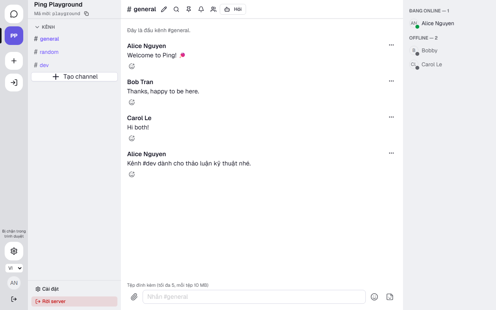
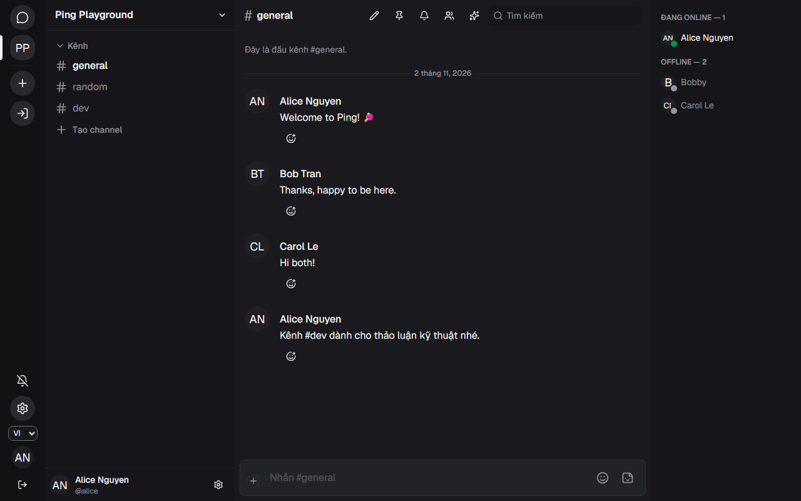

# Hệ thống UI frontend Ping — hiện trạng và hướng làm đẹp

Tài liệu nội bộ, viết 2026-11-01 trên `main` `ca622f3`, cập nhật cùng PR nền UI
([ADR-0075](../adr/0075-single-token-source-va-lop-ping.md)): D1–D14 ở §7 đã làm, nên các mục đó giờ
là **bản ghi "vì sao"** chứ không còn là đề xuất. Mục đích: để một người (OWNER hoặc designer) nắm
được **UI đang được dựng bằng gì**, **cái gì bị ràng buộc bởi máy kiểm**, và **sửa chỗ nào thì đẹp
lên nhiều nhất mà không phá thứ khác**.

Hướng đã chốt: "Expressive Social" kiểu Discord, và từ 2026-11-02 **bám sát Discord**: bề mặt,
khung và mật độ lấy từ Discord thật + Discord UI kit, màu nhấn blurple `#5865F2`, không
gradient/glass ([ADR-0051](../adr/0051-design-direction.md), [direction.md](direction.md)). Mọi đề
xuất dưới đây giữ nguyên hướng đó.

> Lưu ý về con số: mọi px/ms/tỉ lệ trong tài liệu lấy từ code hoặc báo cáo đo, không phải ước lượng.
> Chỗ nào là đề xuất thì ghi rõ "**đề xuất**".

## 1. Bức tranh trong 30 giây

| Câu hỏi                  | Trả lời ngắn                                                                                                                                                           |
| ------------------------ | ---------------------------------------------------------------------------------------------------------------------------------------------------------------------- |
| Dựng bằng gì             | Next.js 16 + Tailwind 4 cho bố cục, **antd 6 bọc trong 34 file `Ping*`** cho control                                                                                   |
| Nguồn màu/kích thước     | 1 file TS (`lib/theme/tokens.ts`) sinh `styles/tokens.generated.css`; `globals.css` chỉ nối token vào Tailwind                                                         |
| Bao nhiêu màn            | 6 màn lớn (login, chat, search, settings, admin, ask) × 2 theme × 3 viewport × 2 skin = **72 ảnh chuẩn**                                                               |
| Cái gì máy chặn          | import antd sai chỗ, hex/màu thô ngoài token, tương phản < 4,5:1, ranh giới control < 3:1, chuyển động > 200 ms, thang độ đậm lạ, tầng nền sai thứ tự, axe ≠ 0 vi phạm |
| Cái gì máy **chưa** chặn | nhịp thị giác tổng thể, chất lượng điểm nhấn — phần "đẹp" vẫn do người quyết                                                                                           |



## 2. Ba lớp của hệ thống

```
tokens.ts ──► gen-theme-css.mjs ──► styles/tokens.generated.css (--ping-*)
   │                                        │
   │                                        └─► globals.css @theme ─► Tailwind class trong màn hình
   └─► antd theme (buildAntdTheme) ─► Ping* wrappers ─► features/*
```

1. **Lớp token** — màu, spacing, radius, typography (cỡ + độ đậm), shadow, motion, z-index. Là nơi
   duy nhất được phép khai báo giá trị thô ([tokens.ts](../../apps/web/src/lib/theme/tokens.ts):1-5);
   CSS sinh ra bằng `pnpm --filter web gen:theme`, CI chặn nếu lệch.
2. **Lớp component** — `components/ui/ping-*.tsx`: 34 file, mỗi file bọc một control antd (hoặc tự
   dựng với `PingKbd`, `PingToast`, `PingAvatar`) và khoá lại API cho hẹp.
3. **Lớp màn hình** — `features/*` và `app/*`: chỉ dùng `Ping*` + class Tailwind tham chiếu token.

Ranh giới này được **lint cưỡng chế** ([eslint.config.mjs](../../apps/web/eslint.config.mjs)):
`src/**` không được `import 'antd'`, trừ `components/ui`, `lib/theme`, `providers` và 5 file layout;
cấm 23 bảng màu thô (`bg-blue-500`, `text-red-600`…) ở **mọi** file `src/**/*.tsx`, kể cả wrapper —
wrapper cũng lấy màu từ token.

## 3. Token — con số thật

### 3.1 Màu

Palette gốc: nhóm `surface`/`blurple`/`blue` **đo từ Discord web** (1280×800, DPR 1, theme
`theme-darker` + `visual-refresh`, bản sáng), cộng xám `ink-50…950` cho chữ/viền và `green`/`amber`/
`red` cho trạng thái ([tokens.ts](../../apps/web/src/lib/theme/tokens.ts):117-168). Ngữ nghĩa tách
theo theme:

| Token                   | Sáng                 | Tối                     | Dùng ở                         |
| ----------------------- | -------------------- | ----------------------- | ------------------------------ |
| `background`            | `#ffffff`            | `#1a1a1e`               | vùng chat                      |
| `sidebar`               | `#fbfbfb`            | `#16161a`               | cột kênh, panel thành viên     |
| `rail`                  | `#f3f3f4`            | `#121214`               | cột server 72 px               |
| `card`/`popover`        | trắng                | `#222327` / `#242429`   | composer, thẻ, menu, modal     |
| `primary`               | blurple `#5865F2`    | blurple `#5865F2`       | nút chính, link, focus         |
| `muted-foreground`      | ink-600 `#6b6d78`    | ink-420 `#96979e`       | chữ phụ, timestamp             |
| `border`                | ink-200 `#dddee2`    | trắng 12% (`#96979e1f`) | đường kẻ phân cách             |
| `border-strong`/`input` | ink-450 `#87898f`    | ink-600 `#6b6d78`       | viền ô nhập, ranh giới control |
| `field`                 | đen 6% (`#0000000f`) | đen 12% (`#0000001f`)   | ô tìm kiếm phẳng trên nền chat |
| `link`                  | `#006dd4`            | `#4d96ee`               | link trong nội dung            |

Ba điểm đáng nhớ:

- `muted-foreground` sáng nâng lên **ink-600** vì bản cũ ink-500 chỉ đạt 4,18:1 trên trắng — axe bắt
  được ở T6.9.
- `primary` đổi từ violet-600 sang **blurple `#5865F2`**: chữ trắng trên nền này = **4,61:1**, đạt
  AA (đậm hơn brand-600 của Discord sẽ lệch màu thương hiệu). Dùng cùng một mã ở hai theme để nút
  chính và focus ring khớp Discord.
- **W1 đã đóng** (D1): `--input`/`border-strong` đạt 3,50:1 (sáng) và 3,05:1 (tối) trên `card` —
  `audit:design` in ra từng con số. `--border` chỉ 1,34 / 1,53 nhưng là đường phân cách nên audit
  ghi chú, không coi là vi phạm 1.4.11.

### 3.2 Kích thước, bo góc, chuyển động

| Nhóm       | Giá trị                                                                                        |
| ---------- | ---------------------------------------------------------------------------------------------- |
| Spacing    | 0/4/8/12/16/20/24/32/40/48/64 px (bội 4, script kiểm)                                          |
| Radius     | sm 6 · md 8 · lg 12 · xl 16 · full (antd dùng đúng thang này)                                  |
| Typography | 12/14/16/18/20/24 px; line-height 1,2 / 1,5 / 1,7; Geist + Geist Mono (có subset tiếng Việt)   |
| Motion     | fast 120 ms · normal 200 ms · slow 200 ms (**trần 200**)                                       |
| z-index    | dropdown 1000 · sticky 1020 · modal 1050 · toast 1100 · tooltip 1200                           |
| Bố cục     | rail 72 px · sidebar 303 px · header 49 px · panel phải 240 px (pin 288 px) · composer 57,6 px |

Hai khung đo từ Discord thành token Tailwind trong `@theme inline`
([globals.css](../../apps/web/src/app/globals.css)): `--spacing-sidebar: 303px` (cột kênh) và
`--spacing-header: 49px` (header server, kênh và DM), nên component dùng `w-sidebar`/`h-header` thay
vì giá trị tuỳ ý. Cài đặt cá nhân dùng `--spacing-settings-nav: 232px` và
`--container-settings-content: 740px` (`max-w-*` đọc namespace `--container-*` của Tailwind 4, không
phải `--spacing-*`).

Radius Tailwind giờ đọc thẳng token (`--radius-lg: var(--ping-radius-lg)`), nên `rounded-lg` = 12 px
khớp antd. Đổ bóng chỉ còn hai token cho lớp nổi — `shadow-panel` (drawer/modal/panel) và
`shadow-overlay` (menu/dropdown/popover); `shadow-xs/sm/md/xl` rời đã bị thay hết.

### 3.3 Theme hoạt động thế nào

`ThemeProvider` đọc `theme` (sáng/tối/hệ thống), `density`, `fontSize`, `skin` từ store, theo dõi
`prefers-color-scheme`, rồi ghi `data-theme`, `data-density`, `data-font`, `data-skin` lên `<html>` và
bọc antd `ConfigProvider` (locale vi/en, algorithm light/dark, skin, motion 200/120)
([theme-provider.tsx](../../apps/web/src/providers/theme-provider.tsx):41-60).

Đổi cỡ chữ: `100% = 16px`, `sm = 15px`, `lg = 18px`; density thu gọn đổi padding tin nhắn
6 → 2 px và line-height 1,5 → 1,3 ([globals.css](../../apps/web/src/app/globals.css):216-233).

Nợ đã biết: ADR-0050 dự định đọc theme từ cookie **trước hydrate**; hiện đọc `localStorage` trong
client provider nên lần vẽ đầu có thể nháy sáng trước khi vào theme tối. Skin Pixel dùng cùng cơ chế
(cookie đọc trong client) nên cũng có thể nháy một khung hình khi tải lại bằng skin Pixel.

### 3.4 Skin Pixel (ADR-0076)

Trục `data-skin` độc lập với sáng/tối: `default` (không attr hoặc `data-skin="default"`) là giao diện
Discord ở trên; `pixel` đổi **hình thức**, không đổi màu/nhịp:

| Thuộc tính    | Mặc định                                | Pixel                                              |
| ------------- | --------------------------------------- | -------------------------------------------------- |
| Bo góc        | sm 6 · md 8 · lg 12 · xl 16 · full 9999 | tất cả 0 (avatar và chấm trạng thái thành ô vuông) |
| Viền Tailwind | 1 px                                    | 2 px (`--ping-border-width`)                       |
| Bóng          | mềm, alpha 10–60%                       | cứng `3px 3px 0` / `5px 5px 0`, không blur         |
| Chuyển động   | `cubic-bezier(0.2, 0, 0, 1)`            | `steps(2, end)`                                    |

Giá trị khai trong `skins.pixel` ([tokens.ts](../../apps/web/src/lib/theme/tokens.ts)) và sinh thành
khối `html[data-skin='pixel']`; antd nhận qua `buildAntdTheme(mode, skin)` (bo 0, `lineWidth` 2, bóng
cứng). Skin lưu ở cookie `ping-skin` — **theo thiết bị**, không PATCH server, không vào cache
`localStorage` của cài đặt. Không dùng font pixel: Pixelify Sans thiếu subset tiếng Việt.

## 4. Lớp component — 34 file

Bọc antd, thêm `data-testid`, khoá API: `PingAlert`, `PingBadge`, `PingButton`, `PingIconButton`,
`PingCheckbox`, `PingContextMenu`, `PingDivider`, `PingDrawer`, `PingDropdown`, `PingEmpty`,
`PingForm` (+`PingFormItem`, `usePingForm`, `zodFormRules`), `PingInput`, `PingKbd`, `PingLabel`,
`PingMentionInput`, `PingMenu`, `PingModal`, `PingPasswordInput`, `PingPopconfirm`, `PingPopover`,
`PingRadioGroup`, `PingSegmented`, `PingSelect`, `PingSkeleton`, `PingSpinner`, `PingSteps`,
`PingSwitch`, `PingTable`, `PingTabs`, `PingTag`, `PingTextArea`, `PingToast`, `PingTooltip`,
`PingAvatar`.

Vài chỗ đáng chú ý vì ảnh hưởng trực tiếp tới thẩm mỹ:

- `PingButton` tự định nghĩa `primary | secondary | ghost | danger` + `sm | md | lg` rồi map sang
  antd → muốn đổi hình thức nút thì sửa **một** file.
- `PingTag` thay preset `green` của antd (chữ trắng trên nền sáng, dưới 4,5:1) bằng cặp token
  `success-background` / `success-foreground` — 4,84:1 ở nền sáng, 9,94:1 ở nền tối.
- `PingAvatar` tự dựng chấm presence 10×10, không dùng antd Badge. Mặc định của antd là chữ
  trắng trên nền đen pha 25% (2,29:1 — axe bắt ở icon server đang chọn), nên `buildAntdTheme`
  ghim `Avatar.colorTextPlaceholder = muted` + `colorTextLightSolid = foreground` (16,53:1 nền
  sáng, 12,14:1 nền tối); nền thương hiệu của icon đang chọn truyền qua `style`.
- `PingTable` có API riêng (`columns{key,header,render}`, `rows`, `rowKey`).
- `PingTooltip` đặt `styles.root.pointerEvents: none`: tooltip là thứ chỉ để đọc, nhưng antd mặc
  định cho nó bắt pointer — tooltip của rail server đè lên danh sách kênh và nuốt cú bấm bên dưới
  (e2e treo tới timeout). Đừng bỏ qua nếu đổi cách render tooltip.
- Thanh header cố định 48 px chỉ đủ hai dòng khi tên 14 px và nút icon cỡ `small` (24 px); antd
  `controlHeight` mặc định 36 px sẽ ép chữ còn 11 px (đã gặp ở header sidebar kênh).

**Một bộ duy nhất (D11):** 9 file shadcn/Radix (`button`, `dialog`, `tooltip`, `avatar`,
`dropdown-menu`, `input`, `textarea`, `label`, `skeleton`) và `components.json` đã xoá; các dependency
Radix/CVA cũng ra khỏi `apps/web/package.json`. `src/components/ui/` chỉ còn `Ping*`, và lint chặn
`import 'antd'` ngoài lớp UI nên một bộ thứ hai không thể mọc lại. Kho giao diện để xem tay nằm ở
`/dev/ui` (chỉ dựng khi `next dev`) — liệt kê đủ 34 file.

**CSS của antd không nằm trong layer của Tailwind.** cssinjs chèn `<style>` lúc chạy, không bọc
`@layer`, nên nó thắng mọi utility trong `@layer utilities` khi cùng độ đặc hiệu: đặt `bg-*`,
`text-*`, `rounded-*`, `size-*` lên chính phần tử antd là **không có tác dụng** (đã gặp ở avatar
rail — `bg-primary` bị nền 25% của antd đè, axe báo 2,29:1). Muốn đổi màu/cỡ/bo góc bên trong
component antd: sửa token component trong `buildAntdTheme`, hoặc truyền `style` (vẫn dùng biến
token); class để cho layout và những thuộc tính antd không đặt.

Với thẻ `<a>`, antd còn **sinh dải màu từ seed** `colorLink` thay vì dùng thẳng giá trị đó: theme
tối ra `#4483cd` (4,01:1 trên card `#222327`) dù `--link` là `#4d96ee` (5,17:1) — axe bắt được ở
trang login/register. Vì vậy link nào cần đúng màu token thì đặt `text-link` trên `<span>` con
(login, register, quên/đặt lại mật khẩu, xác minh email); đừng tin class trên chính `<Link>`.

## 5. Ngôn ngữ thị giác hiện tại



Đọc từ ảnh và từ class thật:

- **Ba tầng nền**: rail đậm nhất → sidebar → vùng chat sáng nhất, và thứ tự này giờ được máy kiểm
  (độ sáng tương đối 0,897 → 0,965 → 1,000 ở nền sáng; 0,006 → 0,008 → 0,011 ở nền tối).
- **Khung đo theo Discord**: rail 72 px với icon 40×40 và vạch chọn bên trái; cột kênh 303 px;
  header 49 px không viền dưới; ô tìm kiếm 244×32.
- **Phẳng, viền mảnh, gần như không bóng**: tin nhắn không có card, không border, chỉ
  `hover:bg-accent/50`; header và cột kênh tách nhau bằng tầng nền, không bằng viền.
- **Nhịp tin nhắn** (D3): avatar 40 px, nội dung thụt 72 px, chữ 16/22; cùng tác giả trong ≤ 5 phút
  thì ẩn header, `padding-top` 2 px trong nhóm; giữa hai nhóm 16 px
  (`--ping-message-gap`, compact 8 px). Ngày mới có đường phân cách riêng.
- **Danh sách kênh Discord**: dòng 32 px, bo 8, đệm 4/8, chữ 16/500, icon `#` 20 px; nhãn nhóm
  14/500; "Tạo channel" là hàng phẳng như một mục danh sách.
- **Panel người dùng** ở đáy cột kênh: avatar 32 + tên 14/500 + `@username` 12, nút cài đặt bên
  phải; rail có cụm cố định ở đáy (thông báo, cài đặt, ngôn ngữ, avatar, đăng xuất).
- **Composer** (D6): `bg-card` (`#222327`) + viền trắng 12%, radius 8, đệm 10, cao 57,6 px;
  focus-within đổi viền `primary` + ring 2 px; nút đính kèm là dấu `+` trong vòng tròn.
- **Nhấn màu rất tiết chế**: blurple chỉ ở nút chính, link, focus ring, viền trả lời; còn lại là xám.
- **Icon**: lucide-react, kích thước 16/20, độ dày nét mặc định.

Điểm mạnh: sạch, không rối, dễ đọc, dark mode chỉnh kỹ. Phần "đẹp" giờ đến từ nhịp (nhóm tin, thang
đậm, khoảng cách kênh) và điểm nhấn đúng chỗ (composer, trạng thái rỗng có icon 32 px), không từ
hiệu ứng.

## 6. Cái gì bị máy kiểm — sửa UI phải qua cửa này

| Cổng              | Nội dung                                                                                                                                                                                                  | Chạy bằng                                          |
| ----------------- | --------------------------------------------------------------------------------------------------------------------------------------------------------------------------------------------------------- | -------------------------------------------------- |
| ESLint            | cấm `import 'antd'` ngoài lớp UI; cấm 23 bảng màu thô ở mọi `.tsx`; 15 luật jsx-a11y                                                                                                                      | `pnpm --filter web lint`                           |
| `design-audit`    | 15 cặp chữ ≥ 4,5:1 + 3 cặp UI cứng ≥ 3:1 + `--border` ghi chú (mỗi theme) + 7 cặp antd; lưới 4 px; sàn 12 px; 3 bậc độ đậm; thứ tự 3 tầng nền; motion ≤ 200 ms; cấm hex ngoài allowlist; cấm `!important` | `pnpm --filter web audit:design` (CI job `verify`) |
| axe (Playwright)  | WCAG 2.1 A/AA, 0 vi phạm trên 6 nhóm màn, sáng + tối                                                                                                                                                      | `pnpm --filter web test:e2e`                       |
| Visual regression | 72 ảnh/`platform` (36 mặc định + 36 Pixel), `threshold 0.3`, `maxDiffPixelRatio 0.015`                                                                                                                    | `pnpm --filter web test:visual`                    |
| Bundle            | JS tải ban đầu ≤ 450 KB gzip (hiện 248,2 KB)                                                                                                                                                              | `pnpm --filter web check:bundle`                   |

Điều này có nghĩa: **đổi màu/bo góc/khoảng cách thì máy sẽ hét nếu sai luật**, còn **đổi bố cục
thì 72 ảnh baseline sẽ đỏ** — bạn phải chủ động cập nhật ảnh và mở ảnh diff ra xem, không được
"cho xanh" bằng cách bỏ qua.

## 7. Hướng làm đẹp cụ thể

Xếp theo mức "nhìn thấy ngay" trên mỗi giờ bỏ ra. Mỗi mục: hiện trạng → đề xuất → vì sao đẹp hơn →
cách kiểm. Bạn chọn mục nào cũng được, chúng độc lập trừ khi ghi "phụ thuộc".

> **Trạng thái 2026-11-01:** cả D1–D14 đã làm trong PR nền UI ([ADR-0075](../adr/0075-single-token-source-va-lop-ping.md)).
> Đọc lại mục nào thì đối chiếu mã hiện tại: `lib/theme/tokens.ts`, `scripts/gen-theme-css.mjs`,
> `scripts/design-audit.mjs`, `specs` của test `src/lib/theme/tokens.test.ts`.

### Nhóm A — sửa nhanh, thấy ngay (mỗi mục ≤ nửa ngày)

**D1. Viền ô nhập đọc được (đồng thời đóng ngoại lệ W1)**
Trước: `--input` = ink-200 → 1,35:1 trên nền sáng, dưới ngưỡng 3:1; người dùng phải đoán ô nhập
nằm ở đâu. Đề xuất: thêm token `--border-strong` = ink-500 `#7a7a92` (sáng, 4,18:1 trên trắng) /
ink-400 (tối), dùng riêng cho viền input, checkbox, segmented, ô tìm kiếm; giữ ink-200 cho đường kẻ
phân cách. Đẹp hơn: khối form "có hình", mắt bắt được vùng nhập; a11y đạt 1.4.11. Kiểm: `audit:design`
(đã có cặp `input`), axe, ảnh visual 6 màn.

**D2. Token hoá đổ bóng (3 mức, chỉ cho lớp nổi)**
Trước: 4 mức Tailwind rải rác (xs/sm/md/xl), không có token. Đề xuất: `shadow.raised` cho popover
nhỏ, `shadow.overlay` cho menu/dropdown, `shadow.panel` cho drawer/modal; giá trị gợi ý (nền sáng):
`0 1px 2px rgb(23 23 38 / .06)`, `0 4px 12px -2px rgb(23 23 38 / .10)`,
`0 16px 40px -8px rgb(23 23 38 / .18)`; nền tối tăng alpha ~1,5×. Vẫn **không** đổ bóng cho nội dung
(tin nhắn, card) — chỉ lớp nổi. Đẹp hơn: phân tầng rõ mà vẫn phẳng. Kiểm: đổi 13 chỗ dùng `shadow-*`
(4 header, 1 popover composer, 3 popover, 5 drawer/panel).

**D3. Nhịp tin nhắn: phân nhóm theo người gửi**
Trước: mỗi tin đều lặp tên + giờ; khoảng cách giữa hai tin cùng người bằng khoảng cách giữa hai
người khác nhau (đều `py` 6 px). Đề xuất: cùng tác giả trong ≤ 5 phút thì ẩn header, giảm
`padding-top` còn 2 px; giữa hai nhóm 12 px. Dùng biến `--ping-message-py` đã có, thêm
`--ping-message-gap` để không phá chế độ compact. Đẹp hơn: kênh đông tin đọc nhanh hơn nhiều, mắt
thấy "khối" thay vì "danh sách". Lưu ý: ảnh baseline 6 màn đều đổi → cập nhật có chủ đích.

**D4. Thang đậm chữ (weight) thành token**
Trước: chỉ có `fontSize`/`lineHeight`, còn độ đậm là class rải rác (`font-semibold` cho tên,
`font-medium` cho nhãn). Đề xuất: thêm `typography.weight = {regular 400, medium 500, semibold 600}`
và một bảng vai trò: tên người gửi 600/14, tiêu đề màn 600/20, tiêu đề mục 600/16, chữ phụ 400/12.
Đẹp hơn: phân cấp thị giác ổn định, không phải đoán. Kiểm: `audit:design` có thể thêm luật cấm
`font-*` lạ nếu muốn siết.

**D5. Thống nhất focus ring**
Trước: chỗ `ring-3 ring-ring/50`, chỗ `ring-2 ring-ring` (13 file). Đề xuất: một quy ước
2 px ring + 2 px offset, màu `--ring`, áp cho mọi phần tử tương tác; đưa vào một class tiện ích
trong `globals.css` thay vì lặp. Đẹp hơn: bàn phím đi tới đâu thấy rõ tới đó, không "nhảy" độ dày.

### Nhóm B — một đến hai ngày, đổi cảm giác

**D6. Làm rõ khung composer**
Trước: ô nhập trần trên nền, không viền, không nền; khó thấy biên. Đề xuất: bọc trong khung
`bg-card`, `border` (dùng `--border-strong` sau D1), radius 12, padding 12, focus-within thì viền
`primary` + ring 2 px; hàng icon 20 px, nút gửi chỉ hiện khi có nội dung. Đẹp hơn: trọng tâm màn
chat rõ ràng, giống sản phẩm hoàn chỉnh. Ảnh hưởng: baseline màn chat + search.

**D7. Làm sâu tầng nền (đặc biệt dark mode)**
Trước: tối dùng ink-950/900/850 nhưng rail và sidebar **cùng** ink-900 → mất tầng. Đề xuất:
`surface-0` (nền chat), `surface-1` (sidebar), `surface-2` (rail) tách nhau ≥ 1 bước sáng/tối;
thêm 1 đường kẻ 1 px chỉ ở chỗ cần. Đẹp hơn: khối khu vực tách bạch, đỡ "một màu". Kiểm: đo lại
tương phản chữ trên cả 3 nền (ngưỡng 4,5:1).

**D8. Danh sách kênh có tiết tấu**
Trước: mỗi dòng `px-2 py-1.5 text-sm`, header nhóm 12 px viết hoa. Đề xuất: dòng cao 32 px, radius
8, icon 16 + khoảng 8; header nhóm 11 px/600, letter-spacing 0.06em, cách trên 16 px; badge chưa đọc
canh phải cùng baseline. Đẹp hơn: quét mắt dọc nhanh, nhóm rõ.

**D9. Trạng thái rỗng / đang tải có "chỗ đứng"**
Trước: skeleton có `role="status"` nhưng chưa khớp nhịp tin nhắn; empty state đôi chỗ chỉ có chữ.
Đề xuất: skeleton đúng 3 dòng (avatar 40 + 2 dòng), empty có icon 32, một câu giải thích và **một**
nút hành động. Đẹp hơn: chuyển trạng thái không nhảy layout, cảm giác "được thiết kế" chứ không
phải "đang chờ".

**D10. Chuyển động có chủ đích**
Trước: 120/200 ms rải rác, thiếu easing chung. Đề xuất: thêm `--ping-ease: cubic-bezier(.2, 0, 0, 1)`;
chỉ 3 loại chuyển động: hover màu (120 ms), mở/đóng lớp nổi (200 ms), danh sách chèn phần tử không
animate vị trí. Không scale quá 1,02. Đẹp hơn: mượt mà không "nhún nhảy".

### Nhóm C — dài hơi, dọn nền để đẹp bền

**D11. Dứt điểm hai bộ component**
Chuyển 24 file còn dùng shadcn/Radix sang `Ping*` tương ứng (Button→PingButton, Dialog→PingModal,
Tooltip→PingTooltip, Avatar→PingAvatar, Input/Textarea/Label/Skeleton→Ping*). Đẹp hơn: một thang
radius/shadow/focus duy nhất; hết hiện tượng "hai cái modal hơi khác nhau". Rủi ro: đụng nhiều file,
phải chạy full web e2e + cập nhật baseline.

**D12. Sửa thang radius lệch tên**
Đặt lại mapping để `rounded-lg` = 12 px trùng token (hoặc đổi tên token thành số), thay vì 4,8/6,4/8…
Đẹp hơn: bo góc đồng nhất giữa antd và Tailwind. Rủi ro: đổi gần như mọi bề mặt → làm cùng lúc với
D11, cập nhật baseline một lần.

**D13. Token hoá màu trạng thái**
`PingTag` đang hardcode emerald; nên có `success/warning/info` trong `tokens.ts` và map Tag/Presence/
Alert theo đó, kèm kiểm tương phản. Đẹp hơn: màu trạng thái đồng bộ ở badge, chấm online, alert.

**D14. Bỏ chữ 10/11 px (ngoại lệ W4)**
Nhãn 10–11 px khó đọc, nhất là tiếng Việt có dấu. Đề xuất: sàn 12 px cho mọi chữ; chỗ chật thì tăng
khoảng cách thay vì giảm cỡ. Đẹp hơn: dễ đọc, đồng bộ thang.

### Nếu muốn đi xa hơn: ba hướng thẩm mỹ

| Hướng                                    | Mô tả                                                                      | Đánh đổi                                                              |
| ---------------------------------------- | -------------------------------------------------------------------------- | --------------------------------------------------------------------- |
| **A. Tinh chỉnh hiện tại** (khuyến nghị) | Giữ xám + tím, chỉ làm D1–D10: viền đọc được, nhịp tin nhắn, nhấn đúng chỗ | Ít rủi ro, giữ được bản sắc; "đẹp" đến từ chi tiết, không từ hiệu ứng |
| B. Thêm cá tính bằng bề mặt nhấn         | Một dải màu tím nhạt cho header/empty, gradient rất nhẹ ở trạng thái rỗng  | Dễ lệch hướng "phẳng"; cần đo tương phản lại toàn bộ                  |
| C. Dày đặc kiểu Discord                  | Giảm padding, thêm hover mạnh, avatar nhỏ hơn                              | Nhanh nhìn "pro" nhưng mỏi mắt khi đọc lâu; phá ảnh baseline nhiều    |

## 8. Quy trình đổi UI an toàn (đề xuất làm theo đúng thứ tự)

1. Sửa **token trước**, component sau, màn hình cuối — tránh sửa 40 chỗ lẻ. Sửa xong chạy
   `pnpm --filter web gen:theme` và commit file CSS sinh ra (CI chặn nếu quên).
2. `pnpm --filter web lint` + `pnpm --filter web audit:design` (audit cũng chạy trong CI job
   `verify`; chạy local cho nhanh vòng lặp).
3. `pnpm --filter web test:e2e` (có axe, 0 vi phạm).
4. `pnpm --filter web test:visual:update` trên DB sạch `ping_visual`, **xoá thư mục platform trước
   khi cập nhật**, rồi mở ảnh diff xem từng ảnh — không nhận ảnh mới một cách mù.
5. `pnpm --filter web build && pnpm --filter web check:bundle` (trần 450 KB).
6. Commit tách đôi: (a) token + component, (b) ảnh baseline — để review đọc được diff.
7. Merge/push một lần; CI job `visual` sẽ so sánh trên Linux bằng bộ ảnh vừa commit.

Lưu ý môi trường: visual chỉ chạy trên DB vừa migrate + seed (`ping_visual`), không dùng DB dev
chung — xem [TF.13](../v0.2.0/evidence/TF.13/README.md).

## 9. Những thứ không nên làm

- **Gradient, glass, glow, đổ bóng cho nội dung**: đã chốt hướng phẳng; thêm vào sẽ phá cảm giác
  "công cụ" và khó giữ tương phản AA.
- **Đổi `primary` sang màu khác mà không đo**: blurple `#5865F2` đang đạt AA ở cả hai theme
  (4,61:1 với chữ trắng); màu sáng hơn thì nút chính trượt ngưỡng, đậm hơn thì lệch Discord.
- **Cho xanh visual bằng cách bỏ ảnh**: cơ chế CI hiện tự bootstrap nếu thiếu ảnh `linux/`; nếu lạm
  dụng, cổng mất tác dụng (đã ghi ở [ADR-0074](../adr/0074-visual-regression-baselines-va-ci.md)).
- **Chỉnh 1–2 px bằng giá trị tuỳ ý**: `audit:design` hiện báo **0** giá trị px/rem ngoài thang; thêm
  ngoại lệ là bắt đầu trượt khỏi lưới 4 px.
- **Thêm bộ component thứ hai** (shadcn/Radix hay bất kỳ kit nào): `features/*` chỉ dùng `Ping*`
  ([ADR-0075](../adr/0075-single-token-source-va-lop-ping.md)); lint chặn import antd ngoài lớp UI,
  nhưng một kit khác thì phải tự giác.

## 10. Việc cần OWNER quyết trước khi làm đẹp

1. **Ký design review TF.14** — hiện chưa ký, 4 ngoại lệ W1–W4 đang chờ
   ([design-review](../v0.2.0/acceptance/design-review.md):149-157). W1 đã đóng bằng D1; còn W2
   (chưa thử trình đọc màn hình thật), W3 (baseline tách theo hệ điều hành), W4 (vài giá trị ngoài
   thang đã gộp hoặc ghi lý do).
2. **Chọn hướng thẩm mỹ**: A (tinh chỉnh), B (thêm bề mặt nhấn) hay C (dày đặc).
3. **Ngân sách thời gian**: nhóm A ≈ 2–3 buổi; nhóm B ≈ 2–3 ngày; nhóm C ≈ 1 tuần và phải chấp
   nhận đổi toàn bộ 72 ảnh baseline.

Ba thay đổi D1 + D3 + D6 (đã làm) là những chỗ đổi cảm nhận màn chat nhiều nhất mà không đụng bảng
màu; việc còn lại là chọn hướng B/C nếu muốn thêm cá tính.
