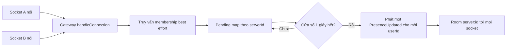

# Case 1 — Bão presence: gộp theo cửa sổ thay vì phát ngay

Trạng thái: hoàn thiện tại T7.2 (2026-11-01). Mức độ: đầy đủ.

## 1. Bối cảnh và vấn đề

Mỗi lần một socket nối hoặc ngắt, API phát `presence.updated` tới room `server:<id>`, nên chi phí
một thay đổi là O(số thành viên trong server). Khi cả server cùng mở lại app sau một lần mạng chập,
N người nối lại gần như đồng thời tạo N lần phát cho N người nhận: bậc hai theo số thành viên.

Đo trên laptop với code v0.1.0 (nhánh `feat/hardening-h7`), 2.000 socket trong **một** server,
3 vòng đóng/nối, giữ 15 giây mỗi vòng: khoảng **4,9 triệu event trong 90 giây** (~23.500 event/giây
tới k6), 2.541 lần nối thất bại và p95 hồi phục **25,3 giây**
([baseline 2026-10-20](../../perf/2026-10-20-baseline.md)). Cùng báo cáo chỉ ra một lỗi độc lập:
lỗi phát presence làm `handleConnection` ngắt socket dù xác thực đã thành công.

T0.6 đo lại ở profile nhỏ hơn, 500 socket, 3 instance, 3 vòng: 919.318 thông điệp WebSocket nhận
trong 71,2 giây (quy đổi tuyến tính ~1,16 triệu/90 giây), p95 reconnect **3,14 giây**, 0 thất bại;
event loop p99 lên **778,6 ms** trong giai đoạn reconnect ([T0.6](../evidence/T0.6/README.md),
[báo cáo](../perf/2026-10-22-baseline.md)). Hai profile khác nhau (2.000 và 500 socket,
một lần chạy mỗi cấu hình); không đọc như cùng thang đo.

## 2. Ràng buộc

- Trần chi phí 20 USD/tháng cho cả staging và AI ([ADR-0038](../../adr/0038-release-scope-v0.2.0.md));
  hạ tầng trả phí bị dời xuống cuối ([ADR-0059](../../adr/0059-defer-paid-infrastructure.md)).
  Vì vậy **T6.2 — bão reconnect trên staging — chưa làm, chưa đo trên staging** và không có thư mục
  `evidence/T6.2`.
- Hợp đồng realtime có sẵn: room `server:<id>` và `user:<id>` ([ADR-0006](../../adr/0006-realtime-authorization-and-presence.md));
  presence nằm trong trang thành viên ([ADR-0030](../../adr/0030-member-presence.md)). Đổi tên event
  hoặc payload sẽ phá client.
- [ADR-0039](../../adr/0039-presence-batching.md) vẫn `proposed`, chưa được OWNER duyệt.
- Không có SLA; mọi số là local, một laptop chạy đồng thời k6, API, Postgres và Redis.

## 3. Phương án đã cân nhắc

1. **Giữ phát ngay:** đơn giản, nhưng không thay đổi chi phí bậc hai.
2. **Event `PresenceBatch` mới:** gói nhiều thay đổi vào một payload, giảm overhead mỗi event
   nhưng phá hợp đồng client và cần migration.
3. **Gộp theo cửa sổ thời gian, giữ nguyên tên/payload** (đã chọn), kèm hướng dẫn client chỉ đăng ký
   thành viên đang hiển thị. Phương án này không đổi client ngay, có thể bật/tắt bằng
   `PRESENCE_BATCH_MS`.

Phương án 3 rủi ro thấp, đo độc lập được. Cái giá: presence trễ ~1 giây; phần “client chỉ đăng ký
thành viên đang hiển thị” mới nằm trong ADR, **chưa làm**.

## 4. Quyết định và thiết kế

`RealtimeGateway` giữ `Map<serverId, Map<userId, 'online' | 'offline'>>` và một timer mỗi server.
Trong cửa sổ `PRESENCE_BATCH_MS` (mặc định 1.000 ms; 0 = phát ngay), nhiều thay đổi của **cùng một
user** gộp còn trạng thái cuối. Hết cửa sổ, gateway phát một `presence.updated` cho mỗi cặp
`(userId, status)` đang chờ tới room `server:<id>`. Tên event và payload `{ userId, status }` không
đổi; truy vấn membership vẫn best-effort, pool cạn thì bỏ presence chứ không sập tiến trình
([realtime.gateway.ts](../../../apps/api/src/modules/realtime/realtime.gateway.ts)).

Điểm quan trọng: gộp theo cửa sổ **không giảm số người nhận**. Mỗi user khác nhau vẫn tạo một event
phát cho cả room; cơ chế chỉ gộp các lần đổi trạng thái lặp lại của cùng user (flapping, nhiều tab,
nối lại liên tiếp). Nếu mỗi user chỉ nối một lần, số event gửi đi gần như không đổi. Vì thế không
được suy ra “từ 4,9 triệu còn X” khi chưa có phép đo after.

## 5. Bằng chứng

| Phép đo                                  | Trước                                                                                     | Sau                                                        | Nguồn                                                 |
| ---------------------------------------- | ----------------------------------------------------------------------------------------- | ---------------------------------------------------------- | ----------------------------------------------------- |
| Event/90 giây, 2.000 socket một server   | ~4,9 triệu (~23.500/s)                                                                    | **chưa đo**                                                | [baseline v0.1](../../perf/2026-10-20-baseline.md)    |
| Event/90 giây, 500 socket                | 919.318 trong 71,2 giây (~1,16 triệu/90 giây quy đổi)                                     | **chưa đo**                                                | [T0.6](../evidence/T0.6/reconnect.json)               |
| p95 reconnect, 2.000 socket              | 25,3 giây; sau khi tách presence khỏi try/catch xác thực: 8,6 và 10,4 giây (hai lần chạy) | **chưa đo sau batching**                                   | [presence-fix](../../perf/2026-10-20-presence-fix.md) |
| p95 reconnect, 500 socket                | 3,14 giây; 0 thất bại                                                                     | **chưa đo**                                                | [T0.6](../evidence/T0.6/README.md)                    |
| Event loop p99 max, reconnect 500 socket | 778,6 ms (fan-out 356,8 ms; REST 25,9 ms)                                                 | **chưa đo**                                                | [T0.6](../evidence/T0.6/metrics-summary.json)         |
| Kiểm chứng chức năng batching            | —                                                                                         | API unit 38, e2e realtime/presence 17 pass, typecheck pass | [T1.2](../evidence/T1.2/README.md)                    |

Con số 8,6/10,4 giây thuộc **bản sửa lỗi ngắt socket**, không phải batching; nó cùng profile 2.000
socket với mốc 25,3 giây. T1.2 (commit `62a7207`, base `6730aec`) chỉ chứng minh hành vi đúng, không
đo tải: evidence ghi rõ “chưa đo baseline 4,9 triệu event/90s và đo lại after”. T6.1–T6.4 nằm ngoài
đợt này ([status](../status.md)).

Chạy lại: lệnh trong [T0.6](../evidence/T0.6/README.md) và [runbook tải](../../perf/README.md).
Số after cần cùng profile với `PRESENCE_BATCH_MS=1000`; lần đo đó **chưa thực hiện**.

## 6. Trade-off và rủi ro còn lại

- Presence trễ tối đa ~1 giây; chấp nhận cho pilot nhưng ảnh hưởng cảm giác “ai đang online”.
- Batching chỉ gộp theo user, không gộp theo người nhận; mục tiêu giảm mạnh chưa được chứng minh.
- Chưa có số after, chưa có staging/proxy/TLS; 500–2.000 socket, không phải 10.000.
- Timer và map là trạng thái trong bộ nhớ một instance; nhiều instance vẫn phát độc lập.
- Pool cạn thì presence bị bỏ, nên im lặng có thể là mất event chứ không phải “offline”.
- Event loop p99 778,6 ms là khối chặn dài; chưa tách được CPU process hay chứng minh nguyên nhân.

## 7. Nếu làm lại / mở rộng tiếp

Đo trước khi tối ưu: thêm bộ đếm `presence_emitted_total` và số event mỗi socket nhận, rồi chạy
cùng profile với `PRESENCE_BATCH_MS=0` và `1000`. Chỉ khi đó mới trả lời được “từ 4,9 triệu còn bao
nhiêu”. Sau đó cân nhắc client chỉ đăng ký thành viên đang hiển thị (mục 3 ADR-0039), phát ảnh chụp
trạng thái thay vì từng user, hoặc giới hạn theo người nhận. T6.2 trên staging, máy tải tách rời và
10.000 socket là điều kiện kết luận capacity.

## 8. Nửa frontend

UI presence nằm ở `features/members/`: `hooks.ts` nghe `presence.updated` và vá **mọi** danh sách
thành viên trong cache qua hàm thuần `setPresence`; user lạ hoặc trạng thái không đổi thì trả lại
object cũ để TanStack không render lại. Reconnect (không phải lần nối đầu) invalidate query thành
viên để bù event bị lỡ. Panel nhóm “Online/Offline”, chấm màu từ token `--online`, kèm chữ ẩn cho
trình đọc màn hình; trạng thái mở panel là Zustand, không lưu.

Frontend nhận presence cho mọi socket trong room channel, không lọc theo trang đang xem, nên chưa
giảm fan-out. Làm mục 3 ADR-0039 cần client gửi phạm vi đăng ký và server lọc người nhận — cả hai
chưa có. Hiện UI coi event lặp là idempotent và chấp nhận chấm online trễ ~1 giây.
