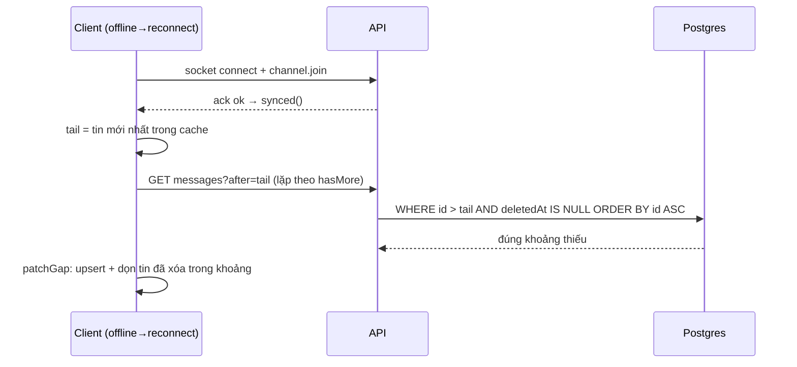

# Case 2 — Dual-write, outbox và giao tin at-least-once; gap recovery ở client

Trạng thái: bản nhánh của T4.4/T4.5 (2026-10-25) — sẽ hoàn thiện số tải ở T7.2. Mức độ: đầy đủ.

## Bối cảnh và vấn đề

Chat realtime giao tin qua Redis pub/sub + Socket.IO: ghi Postgres xong mới phát (`message.created`).
Hai lớp rủi ro: (1) ghi DB xong nhưng phát sự kiện thất bại (Redis chập chờn, process chết)
— tin "đã gửi" nhưng người khác không bao giờ thấy; (2) client mất kết nối đúng lúc có tin —
event chỉ tới socket đang nối, không có gì phát lại. Triệu chứng đo được ở T1.3 khi kill relay
giữa chừng: event tồn đọng, không mất nhưng không đến nơi; ở phía client, thử nghiệm manual
trước T4.4: tab offline trong lúc có tin mới, nối lại phải refetch cả trang mới thấy.

## Quyết định và phương án

- **Outbox (T1.3, ADR kèm evidence T1.3):** ghi `OutboxEvent` trong CÙNG transaction với
  `Message`; relay worker poll `FOR UPDATE SKIP LOCKED`, publish lên Redis Stream, retry/backoff;
  `publishedAt` chỉ đánh dấu sau khi publish thành công. Server-side at-least-once.
- **Gap recovery ở client (T4.4, [ADR-0044](../../adr/0044-gap-recovery.md)):** client không
  lưu `lastSeenId` riêng — tail của cache kênh chính là cursor. Khi `channel.join` thành công
  lại sau reconnect, lặp `GET /channels/:id/messages?after=<tail>` (thứ tự tăng dần,
  `hasMore` còn mới hơn, trần 100/trang) rồi `patchGap` vào cache TanStack: upsert khớp
  id/nonce (không trùng), bỏ tin trong khoảng đã fetch mà server không trả (bị xóa lúc
  offline), giữ nguyên tin optimistic cục bộ và tin đến sau khoảng fetch (event song song).
  Fallback an toàn: cache trống/lỗi vá → refetch như cũ.

Phương án bị loại: replay theo sequence từng user (cần hạ tầng ACK/lưu trữ per-client, quá
mức pilot); poll định kỳ `?after=` (tải nền liên tục không cần thiết); giữ refetch toàn bộ
(tải lại N trang × 50 tin chỉ để lấy vài tin mới).

## Triển khai và kiểm chứng

- T1.3 (đã có evidence): kill relay khi 6 point/5 pending → phục hồi đủ, thiếu/trùng = 0;
  metric `outbox_pending`, `outbox_lag_seconds`.
- T4.4: unit `patchGap` 4 test (chèn đúng chỗ không trùng; bỏ tin đã xóa trong khoảng; giữ
  tin ngoài khoảng + optimistic; fetch rỗng không đổi). API e2e `?after=`: tăng dần, hasMore,
  bỏ tin đã xóa, `before`+`after` → 400. Web e2e `gap-recovery.spec.ts`: offline thật (emulation
  - đóng bridge WS), 100 tin từ 3 tài khoản (nhịp 400 ms/lần tránh 2 lớp rate limit), xóa 1 tin
    lúc offline, nối lại → 99 tin còn lại đầy đủ/đúng thứ tự/không trùng (kiểm mẫu bằng cuộn qua
    danh sách ảo hóa), banner mất kết nối tự biến mất. Chạy 2,4 phút, pass.
- T4.5 (hỗn loạn nhẹ, đã có): chặn frame WebSocket server→page bằng `page.routeWebSocket`
  — rớt 1 frame `message.created` + đảo thứ tự (giữ 1 frame thả sau tin kế tiếp): hiển thị
  không trùng, thứ tự giữ đúng nhờ chèn theo id (insert-sorted); tin bị rớt được vá lại sau
  reconnect bằng merge trang-mới-nhất (tail đã vượt qua nó, `?after=` không thấy nữa).
  Nonce trùng đồng thời (hai POST song song) → cùng id, DB một hàng; optimistic + patch cùng
  nonce → một bản hiển thị.
- Số chưa đo (thuộc T6.1): thời gian vá p95 theo độ dài khoảng trống, tải 10.000 tin.

## Giới hạn và bài học

- Kênh CHƯA TỪNG mở không có cache → không có gì để vá (đúng thiết kế: mở kênh là query mới
  đủ); e2e phải gieo trước 2 tin khi còn online để đi đúng đường vá — chính là điều kiện
  thực tế của người dùng đang mở kênh.
- Hiệu chỉnh xóa chỉ áp dụng trong khoảng `(afterId, maxFetchedId]` — ngoài khoảng là việc của
  refetch nền sau này; tránh đua với event socket đến song song.
- Bài học phỏng vấn: nguồn sự thật là DB; realtime chỉ là bản sao tốt nhất. Server đảm bảo
  at-least-once bằng outbox; client tự chịu trách nhiệm "đón cho đủ" bằng cursor — chia bài
  toán mất gói thành hai nửa nhỏ, mỗi bên một cơ chế đơn giản thay vì một giao thức phân
  phối đảm bảo exactly-once.
