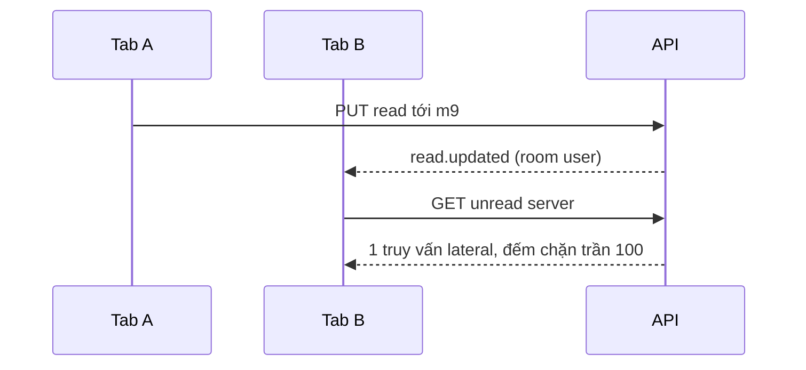

# Case 3 — Unread/mention đa thiết bị với đếm có trần

Trạng thái: hoàn thiện tại T7.2 (2026-11-01). Mức độ: ngắn (ADR-0038).

## Bối cảnh và ràng buộc

Trước Pha 4 chưa có trạng thái đã đọc/mention: mỗi tab tự giữ cursor sẽ lệch badge, còn bộ đếm
trong Redis dễ trôi khi tab chết và không có nguồn đối soát. Chọn Postgres làm nguồn sự thật
([ADR-0043](../../adr/0043-unread-mention.md)): cursor chỉ tiến, `PUT read` idempotent, trần
**100** cho unread/mention, tối đa 20 mention/tin; `@everyone`/`@role` chỉ ghi khi người gửi có
`MENTION_EVERYONE`. Quyền `view Server` cho unread, `view Message` cho mark-read/phát mention.
Không staging nên **p95 chưa đo** (T6.1–T6.4 ngoài lô này).

## Quyết định

`ChannelReadState(memberId, channelId, lastReadMessageId)` + `MessageMention` unique
`(messageId, kind, mentionedMemberId, roleId)`. `GET /servers/:id/unread` là **một** SQL lateral
cho mọi kênh: unread sau cursor, bỏ tin của mình/tin xóa mềm, mention khớp trực tiếp/role/everyone,
`LEAST(...,100)`. Tab khác nhận `read.updated` qua room `user:<id>`; mention có event riêng
`mention.created` (không nhét cờ `mentionsMe` vào `message.created` để khỏi phá ranh giới room);
`channel.activity` chỉ metadata tới room server để badge ngoài kênh đang mở vẫn tăng.

## Bằng chứng

| Tiêu chí        | Kết quả                                             | Nguồn                                           |
| --------------- | --------------------------------------------------- | ----------------------------------------------- |
| Số truy vấn đếm | **1** SQL lateral (chưa tính guard)                 | [T4.2](../evidence/T4.2/README.md)              |
| Trần đếm        | seed 105 tin → trả 100                              | T4.2 test 5                                     |
| Loại trừ        | không đếm tin mình gửi, tin xóa mềm                 | T4.2 test 1, 4                                  |
| Đồng bộ 2 tab   | cả hai socket nhận `read.updated`, badge tab B sạch | T4.2 test 6, [T4.3](../evidence/T4.3/README.md) |
| IDOR            | outsider 403, phủ 25 route                          | T4.2 test 8                                     |
| Hồi quy         | API 182/182, web 28 pass/1 skip, bundle 243,9 KB    | T4.3                                            |

Commit `0da525c`, `4bc5dd9`, `b8b0017`, CI main 8/8 xanh. Chạy lại: `read-state.e2e-spec.ts` và
`pnpm --filter web exec playwright test e2e/unread-ui.spec.ts`. 22,1 giây là cả spec `unread-ui`.

## Trade-off và giới hạn

- **p95 chưa biết**; chi phí tăng theo số kênh và số tin sau cursor, chưa EXPLAIN trên dữ liệu lớn.
- Reconnect gọi unread cho **mọi** server trong rail (chưa có endpoint gộp); `@everyone` ở server
  đông phát ×số người được nhắc — ca xấu cần đo ở T6.1.
- `channel.activity` vẫn tới người không có `VIEW_CHANNEL`; chấp nhận cho pilot (TG.18).
- Trần 100 che số thật; “nhảy sâu tới tin chưa đọc” cũ hơn cửa sổ đã tải thuộc TG.5, chưa có.

## Nửa frontend

`features/unread/` giữ phép biến đổi trong hàm thuần (`unread-cache.ts`: `applyIncoming`,
`applyRead`, `totals`, `firstUnreadId`) để test không cần DOM; reconnect refetch unread mọi server.
UI có badge rail/sidebar, vạch “Tin mới”, tiêu đề `(N) Ping`, `aria-live` cho mention ngoài kênh.
Bài học: đổi `aria-label` theo trạng thái unread làm **15 spec e2e vỡ** — tên tiếp cận là hợp đồng
công khai, nên giữ tên ổn định `# tên kênh` và đặt số trong badge con có test-id riêng.
