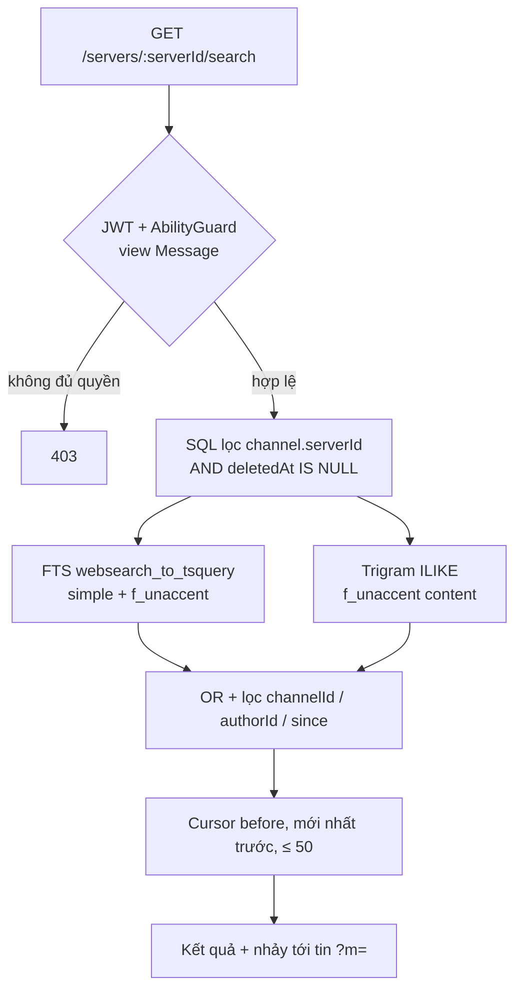

# Case 4 — Tìm kiếm tôn trọng quyền: FTS thay hybrid, và lỗ ACL thật

Trạng thái: hoàn thiện tại T7.2 (2026-11-01). Mức độ: đầy đủ.

## Bối cảnh và vấn đề

Pilot cần tìm lại tin cũ trong một server: tiếng Việt có dấu nhưng người dùng hay gõ không dấu,
từ ghép ("thư viện") thường gõ rời ("thu vien"). Kết quả bắt buộc chỉ thuộc server đang xem,
không trả tin đã xóa mềm, và không được lộ nội dung sang server khác. Yêu cầu ban đầu của kế
hoạch là đi từ FTS sang hybrid (RRF giữa FTS và vector). Triệu chứng cần đo: p95 truy vấn trên
tập dữ liệu lớn, và bằng chứng không rò rỉ qua đường tìm kiếm. Không có số liệu người dùng thật
— mọi thứ dưới đây là seed tổng hợp.

## Ràng buộc

- Ngân sách 0 USD: không thêm Elastic/Meilisearch, không thuê vector DB ngoài (ADR-0038,
  ADR-0059).
- Chế độ 8 tuần: kế hoạch hạ hybrid vector **T5.5** xuống [S] và cắt khỏi phạm vi bắt buộc
  (`docs/ping-v0.2.0-plan.md` mục 6.2; `docs/v0.2.0/status.md`: "Task [S] (T5.5, T5.8…) không
  tính"). Case này **không có số hybrid**.
- Quy ước cursor, không OFFSET; tiếng Việt dùng `unaccent` + cấu hình `simple`.

## Phương án đã cân nhắc

- **Dịch vụ tìm kiếm ngoài** (Elastic/Meilisearch): thêm một hệ phải vận hành, sao lưu, đồng bộ;
  vượt ngân sách pilot. Loại.
- **LIKE thường**: không dùng index, không mở rộng được. Loại.
- **FTS + `ts_rank` xếp hạng**: xếp hạng tốt hơn nhưng keyset composite `(rank, id)` phức tạp,
  rank đổi theo dữ liệu nên phân trang kém ổn định. Loại ở pilot (ADR-0045 ghi trade-off).
- **Hybrid RRF (T5.5)**: đúng hướng dài hạn nhưng là task [S] đã cắt; không triển khai, không
  có số đo. Không dùng số của embedding RAG để thay thế (xem mục Bằng chứng).
- **Chọn**: FTS Postgres (`simple` + `f_unaccent`) **OR** trigram ILIKE, một endpoint SQL tham
  số hóa, lọc quyền trong chính câu SQL.

## Quyết định và thiết kế

[ADR-0045](../../adr/0045-full-text-search.md): cột sinh
`Message.search = to_tsvector('simple', f_unaccent(content))` + GIN; GIN trigram trên
`f_unaccent(content)` cho đường con-chuỗi. `f_unaccent` phải là wrapper `IMMUTABLE` và
schema-qualify `public.unaccent('public.unaccent'::regdictionary, $1)`, nếu không inlining làm
mất dictionary lúc tạo cột/index. Endpoint `GET /servers/:serverId/search`: `q` 1–200, lọc
`channelId`/`authorId`/`since`, cursor `before`, mới nhất trước, `limit ≤ 50`.

Điểm quyết định quan trọng nhất không nằm ở thuật toán mà ở **guard**: T4.6 đặt `view Server`;
T6.5 phát hiện member thiếu `VIEW_CHANNEL` vẫn đọc được nội dung qua search, và đổi sang
`view Message` (`apps/api/src/modules/messages/messages.controller.ts`). Với RAG, nguyên tắc
tương tự được đẩy xa hơn ([ADR-0048](../../adr/0048-controlled-vector-retrieval.md)): xác thực
membership tươi từ Postgres → lọc vector theo `serverId` → hydrate lại tin từ Postgres →
fail-closed theo chunk.

## Bằng chứng

Đo p95 trên seed **20.000 tin tiếng Việt** (2 kênh, trải 90 ngày), 200 lần/truy vấn, lớp SQL
đúng câu lệnh service dựng; máy dev Windows, Postgres 18 trong Docker; commit `dc31744`
([T4.6](../evidence/T4.6/README.md)):

| Truy vấn                            | Kết quả   | p50     | p95         | p99     |
| ----------------------------------- | --------- | ------- | ----------- | ------- |
| FTS từ phổ biến ("báo cáo")         | 26 (trần) | 46,6 ms | **51,3 ms** | 55,2 ms |
| FTS cụm 2 từ ("họp nhóm")           | 26        | 7,4 ms  | **8,5 ms**  | 10,6 ms |
| Trigram con chuỗi trong từ ("áo c") | 26        | 17,0 ms | **19,9 ms** | 22,9 ms |
| Không khớp                          | 0         | 1,1 ms  | **1,4 ms**  | 1,6 ms  |

Đây là baseline local, **không phải p95 staging**: chưa có số T6.1 cho search.

Kết quả chống rò rỉ:

- T4.6: e2e search **5/5** — có dấu/không dấu, con chuỗi trong từ, lọc kênh/tác giả/thời gian,
  cursor, tin xóa mềm biến mất, server B cùng từ khóa không lọt, outsider 403; API e2e tổng
  **188/188**, web e2e 31 pass/1 skip.
- T6.5: **lỗ thật** — guard `view Server` cho phép member thiếu `VIEW_CHANNEL` đọc nội dung qua
  search; vá sang `view Message`, thêm ca hồi quy hạ `@everyone` về `permissions: '0'` → member
  403, owner 200. Rate limit **30 truy vấn/phút/user** (`SearchRateLimiter`), fail-open khi Redis
  chết theo ADR-0026. Bảng IDOR khi đó **61 endpoint**, `idor.e2e-spec.ts` 5/5; API unit
  **307/307**, API e2e **365/365** ([T6.5](../evidence/T6.5/README.md), commit `057c8c5`, base
  `132acfb`).
- T5.4: truy xuất vector fail-closed **9/9** — outsider, user vừa bị kick còn cache, thiếu
  `VIEW_CHANNEL`, tin đã xóa, payload cross-server, payload hỏng, lọc channel, channel không
  thuộc server (base `ecf8fde`, [T5.4](../evidence/T5.4/README.md)).

**Về hybrid và recall@5:** T5.5 chưa triển khai nên **recall@5 của hybrid: chưa có**; recall@5
của FTS cũng **chưa đo** — T4.6 chỉ kiểm đúng/sai bằng e2e, không có bộ truy vấn chuẩn cho
search. Con số recall@5 duy nhất trong repo là của **embedding RAG** (T5.1/ADR-0046):
`multilingual-e5-small` **1,00**, MiniLM tiếng Anh **0,80**, baseline túi từ **0,92** trên 50 tin
và 25 truy vấn. ADR-0046 tự ghi corpus nhỏ nên e5 chạm trần; số này **không phải** xếp hạng
search và không được dùng để tuyên bố hybrid tốt hơn FTS.

## Trade-off và rủi ro còn lại

- Không xếp hạng relevance: kết quả mới nhất trước. Từ phổ biến nhận 26 kết quả mới nhất, không
  phải liên quan nhất; cursor đơn giản đổi lại chất lượng xếp hạng.
- Từ đơn rất phổ biến chạm trần 26 và p95 ~51 ms; từ < 3 ký tự đi đường trigram chậm hơn. Chưa
  có ngưỡng p95 bắt buộc cho search.
- `simple` không tách từ tiếng Việt: gõ rời "thu vien" không khớp token "thuvien".
- Quyền vẫn **server-wide**: chưa override theo channel, nên search phân biệt `VIEW_CHANNEL` ở
  mức server chứ chưa từng kênh.
- Rate limit fail-open khi Redis chết; dung lượng GIN và chi phí ghi chưa đo lại (ADR-0045 để
  T6.1; chưa có evidence).
- Bài học phỏng vấn: "Tôi không chọn hybrid vì kế hoạch 8 tuần đã cắt nó; thay vào đó tôi đo p95
  FTS thật và tìm ra một lỗ ACL thật — guard đúng chỗ quan trọng hơn thuật toán xếp hạng."

## Nếu làm lại / mở rộng tiếp

- Làm hybrid đúng cách: bộ truy vấn có đáp án, đo recall@5 cho FTS trước, rồi RRF; báo cáo cả
  hai trên cùng corpus, cùng máy.
- Thêm `ts_rank` có kiểm soát hoặc keyset `(rank, id)` nếu người dùng phản ánh kết quả kém liên
  quan; đo p95 và dung lượng index trên staging; cân nhắc GIN fastupdate.
- Nếu có channel override, mọi đường (REST, socket, search, RAG, unread) dùng chung một hàm
  giải quyết quyền — đúng ghi chú bảo mật của kế hoạch.

## Nửa frontend

`features/search/` gồm `api` + `useSearch` (infinite query theo filter) và `SearchDialog` mở từ
header kênh: debounce **350 ms**, lọc kênh/người gửi/thời gian (7/30 ngày), kết quả hiển thị
kênh · tác giả · thời gian · đoạn trích, bấm → `/channels/:id?m=` nhảy tới tin và tô sáng bằng
`focusId` sẵn có. `since` tính trong event handler vì lint React Compiler cấm `Date.now()` trong
render; `autoFocus` bị cấm theo ADR-0029 nên dùng `focus()` trong effect. Chuỗi i18n namespace
`search` đủ vi/en (parity test + typecheck, [T3.7](../evidence/T3.7/README.md)). UI không tự lọc
quyền — dựa vào 403/404 của API; khi T6.5 đổi guard, dialog chỉ map lỗi theo mã, không sửa state.
