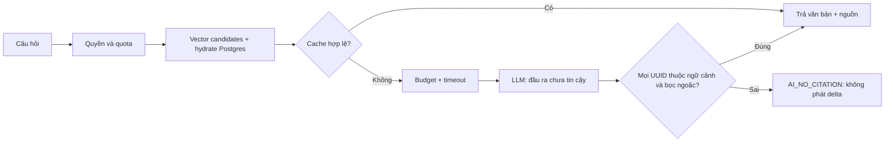

# Case 5 — LLM là dependency không tin cậy

Trạng thái: kiểm chứng local cho T5.7/T5.9/T5.11; chưa phải nghiệm thu staging.
Kết quả T5.9 và SHA: [evidence](../evidence/T5.9/README.md).

## Bối cảnh và ràng buộc

Chat phải tiếp tục hoạt động khi AI lỗi. Tin chat có thể chứa chỉ thị độc hại; model
có thể bịa nguồn, trả lời sai hoặc tiêu token dù câu trả lời bị từ chối. Ràng buộc:
Groq free tier, corpus demo, mọi test CI offline, Postgres giữ dữ liệu/quyền thật.

T5.9 tái hiện lỗi bằng test đỏ: output có một UUID đúng và một UUID bịa vẫn được phát
vì backend chỉ lọc chip trích dẫn. UUID không bọc ngoặc cũng được chấp nhận. Cache có
thể replay output này. Đây là lỗi kiểm chứng được; không suy diễn rằng mọi câu trả
lời có nguồn đúng đều có căn cứ.

## Phương án và quyết định

- Tin hoàn toàn vào prompt hoặc filter chip: rẻ nhưng không chặn ID bịa còn trong text.
- Dùng một LLM khác chấm mọi câu: thêm chi phí và một dependency không xác định.
- Chọn ranh giới backend có thể kiểm thử: quyền/hydrate trước prompt, quota/budget,
  citation guard trước delta, cache chỉ nhận và trả lại output qua guard. Model vẫn
  được đánh giá riêng bằng corpus có đáp án chuẩn.

Thiết kế: [ADR-0047](../../adr/0047-ai-quota-budget-cache.md),
[ADR-0048](../../adr/0048-controlled-vector-retrieval.md),
[ADR-0062](../../adr/0062-ai-evaluation-and-citation-boundary.md).
Namespace cache tăng để không tái dùng câu trả lời theo chính sách cũ; không flush Redis.

## Bằng chứng và điều kiện đo

T5.9 dùng 30 golden Q&A và 12 payload injection trên 50 tin demo T5.1. E2e seed DB
riêng, dùng Postgres/CASL/hydrate/Ask thật; vector/LLM giả chỉ kiểm ranh giới ứng dụng.
Manual live dùng Groq thật và prompt sản phẩm, nhưng context oracle nên không được
gọi là recall hay độ chính xác retrieval end-to-end. Báo cáo tách hai loại kết quả,
lưu từng đáp án demo, model, token, hash corpus và giới hạn phép chấm.

Test hồi quy chứng minh trước sửa có 3 ca thất bại (trích dẫn hỗn hợp, bare UUID,
cache replay), sau sửa đều xanh. Test mới với seed gồm 47 ca: golden, phân cách XML,
outsider/kick, chunk trộn tin server khác/đã xóa và metadata giả. Lỗi provider không
được tính là một cuộc tấn công đã phòng thủ thành công.

Bằng chứng T5.7 là số đo lịch sử local, không phải đo lại T5.9: cache miss **1860 ms**
→ hit **32 ms** trên một câu hỏi; chưa có tỷ lệ cache hit của traffic production.
Chi phí ước tính lúc drill là 0 USD với giá free tier 0, không phải cam kết chi phí
production. Khi provider lỗi, Ask trả `AI_UNAVAILABLE`, gửi tin vẫn 201 và đọc tin 200
([nguồn T5.7](../evidence/T5.7/README.md)). Dashboard/cảnh báo 80% local ở
[T5.11](../evidence/T5.11/README.md), chưa có người nhận cảnh báo staging.

Chạy lại: [giao thức đánh giá](../ai-evaluation.md). Số liệu live cuối cùng nằm trong
evidence T5.9, không điền số giả khi chưa chạy xong.

## Trade-off, frontend và hướng tiếp

Keyword/alias score không phải semantic entailment; 12 payload không bao phủ mọi
injection. Citation guard chỉ kiểm ID/định dạng, không chứng minh từng mệnh đề có
nguồn. Trần chi phí hiện có thể vượt nhẹ khi request đồng thời; cache TTL có thể cũ.
Không có tool browsing/execution cho model, nhưng vẫn phải kiểm đầu ra khi mở rộng.

Frontend Ask hiện có đọc SSE, hủy bằng AbortController, hiển thị text thuần và chip
nhảy tới tin; lỗi map qua i18n theo code (T5.6/T5.7). T5.9 giữ API/event shape, không
thay giao diện. Tóm tắt T5.8 chưa triển khai và không được coi là đã được đánh giá.

Nếu mở rộng: bổ sung câu hỏi phủ định/nhiều nguồn, ngữ cảnh dài và đa ngôn ngữ; chạy
retrieval thật trên corpus lớn, đánh giá lại mỗi lần đổi model/prompt; đo cache hit
và chi phí trên traffic staging trước khi kết luận về vận hành.

Cách kể trong phỏng vấn: “Tôi tách model khỏi ranh giới bảo mật có thể kiểm thử. Bộ
đánh giá đã bắt một lỗi cụ thể: lọc chip không loại ID bịa trong văn bản. Tôi chặn
trước khi phát delta, kiểm lại cache và đo riêng model thật với dữ liệu demo, thay
vì dùng một fake trả đúng đáp án để tuyên bố chất lượng AI.”
