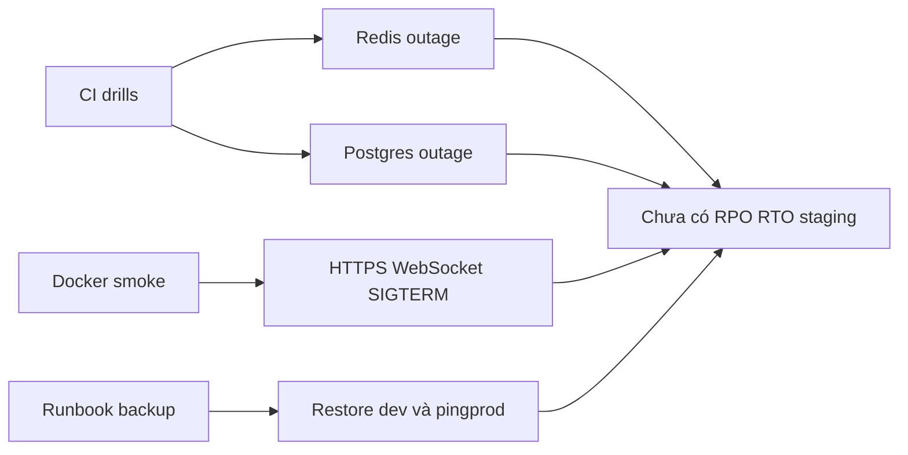

# Case 6 — Vận hành dưới 20 USD

Trạng thái: hoàn thiện tại T7.2 (2026-11-01). Mức độ: đầy đủ.

## Bối cảnh và ràng buộc

Mục tiêu: chạy thật với trần **20 USD/tháng** cho staging, lưu trữ, backup và AI
([ADR-0038](../../adr/0038-release-scope-v0.2.0.md)). Hạ tầng trả phí bị dời xuống cuối
([ADR-0059](../../adr/0059-defer-paid-infrastructure.md)): **T2.1–T2.11 và T6.1–T6.4 chưa làm**
([status](../status.md)). Chưa có VPS, domain, backup ngoài máy, staging hay bảng giá; ADR-0041 chưa
có, RPO/RTO chưa đo; cũng chưa có thư mục evidence cho T2.x/T6.x. Proxy: drill thật trong CI, docker
smoke, runbook, restore local.

## Phương án đã cân nhắc

1. **Dựng VPS staging ngay để có số thật** — đúng cách học vận hành, nhưng tốn tiền trước khi tính
   năng xong, và mọi số RPO/RTO lại phải đo lại sau khi schema còn đổi.
2. **Không làm gì, chỉ viết runbook** — rẻ nhất nhưng runbook chưa chạy thì không ai biết nó đúng;
   lỗi kiểu "restore thiếu `_prisma_migrations`" chỉ lộ khi chạy thật.
3. **Chọn: dùng hạ tầng đã có (CI + Docker local) để kiểm hành vi**, ghi rõ phần không thể suy ra từ
   đó. Cụ thể: job `drills` tắt thật Redis/Postgres, job `docker` dựng stack production qua Nginx
   HTTPS, runbook backup/restore chạy trên DB dev, và mọi ô RPO/RTO/chi phí để "chưa đo".

Cách 3 kiểm được degrade/recovery mà không cần VPS, nhưng **không thay thế** đo RPO/RTO hay load test
từ máy khác. Vì vậy chưa thể tuyên bố "đã vận hành dưới 20 USD": hiện chỉ có trần ngân sách và 0 USD
hạ tầng.

## Bằng chứng có thật và giới hạn

| Hạng mục         | Cách kiểm                                                     | Kết quả                                                                                                                                                                                                                 | Không suy ra được gì                                                                                      |
| ---------------- | ------------------------------------------------------------- | ----------------------------------------------------------------------------------------------------------------------------------------------------------------------------------------------------------------------- | --------------------------------------------------------------------------------------------------------- |
| Tắt Redis        | `pnpm --filter api drill:redis` (CI job `drills`)             | `/ready` = `degraded` nhưng **vẫn 200** (instance ở lại pool), gửi tin 201 trong `< 1.500 ms`, đọc lịch sử 200, đăng nhập 503 `SERVICE_UNAVAILABLE` kèm `requestId`; Redis về thì `/ready` = `ok` không cần restart API | Thời gian phục hồi thật; ngưỡng assert không phải RTO                                                     |
| Tắt Postgres     | `pnpm --filter api drill:postgres`                            | `/ready` 503 (LB loại instance) nhưng `/health` vẫn 200 nên không bị restart; request cần DB trả 503 `SERVICE_UNAVAILABLE` trong `< 6.000 ms`, không treo; DB về thì `/ready` = `ok`                                    | RPO: không drill nào chứng minh mất bao nhiêu dữ liệu                                                     |
| Stack production | CI job `docker` (script `apps/api/test/smoke/prod-stack.mjs`) | Nginx HTTPS + redirect 308 sang HTTPS, web trả CSP, `requestId` đi xuyên proxy, đăng ký → tạo server → socket qua TLS → gửi tin → nhận event → presence, `SIGTERM` thoát mã 0                                           | Tải thật; chạy một máy, một volume                                                                        |
| Backup/restore   | [runbook](../../runbook/backup-restore.md)                    | DB dev **561 user, 146 server, 27.860 tin**; dump → restore DB mới khớp số hàng kể cả `_prisma_migrations`; stack `pingprod` khớp fingerprint 10 bảng ([ADR-0036](../../adr/0036-local-deployment.md))                  | Thời gian restore; mã hoá; bản sao ngoài máy                                                              |
| Tải              | T0.6                                                          | 500 socket **cùng laptop**, không Nginx/TLS ([T0.6](../evidence/T0.6/README.md))                                                                                                                                        | Không phải T6.1; VPS ≥ 4 GB chỉ là ước lượng, chưa đo `docker stats` (kế hoạch local §10.1, không commit) |
| Chi phí AI       | Drill T5.7                                                    | 0 USD trên free tier ([T5.7](../evidence/T5.7/README.md))                                                                                                                                                               | Không phải cam kết chi phí production                                                                     |
| Mục tiêu         | —                                                             | RPO ≤ 24 giờ, RTO ≤ 60 phút là **mục tiêu**, không phải số đo                                                                                                                                                           | Chưa có lịch backup tự động, retention, bản sao ngoài máy hay cảnh báo                                    |

Script và cấu hình: [ci.yml](../../../.github/workflows/ci.yml) (job `drills`, `docker`),
[redis-outage.drill.ts](../../../apps/api/test/drill/redis-outage.drill.ts),
[postgres-outage.drill.ts](../../../apps/api/test/drill/postgres-outage.drill.ts). Cả hai job chỉ chạy
khi code API hoặc hạ tầng đổi, nên không phải bằng chứng cho một bản build cụ thể nào.

## Trade-off, nếu làm lại

Tiết kiệm trước mắt đổi lấy rủi ro: chưa chứng minh khôi phục sau sự cố thật, chưa có backup ngoài
máy; drill CI chứng minh hành vi, không chứng minh thời gian phục hồi. Nếu làm lại, thứ tự là:
ADR-0041 với giá đã xác minh; T2.4 đo RAM bằng `docker stats`; T2.7 backup mã hóa, lịch và retention;
T6.3 ba kịch bản (Redis chết, restart giữa tải, deploy + rollback); T6.4 restore bản mới nhất và ghi
RPO/RTO thực; T6.1/T6.2 từ máy tách rời. Trước đó, mọi ô RPO/RTO/chi phí phải để “chưa đo”.

## Nửa frontend

Frontend không quản backup nhưng là nơi người dùng thấy sự cố: `ConnectionBanner` đọc trạng thái
`connecting/connected/disconnected` của realtime store, tự ẩn khi join lại; unread và DM refetch khi
reconnect. Khi Redis chết, gửi/đọc tin vẫn 201/200 nhưng đăng nhập trả 503 `SERVICE_UNAVAILABLE` kèm
`requestId` — UI map theo mã lỗi, không giả “offline”. Không có màn hình trạng thái hệ thống; không
nên thêm bảng “system status” khi chưa có dữ liệu thật.
