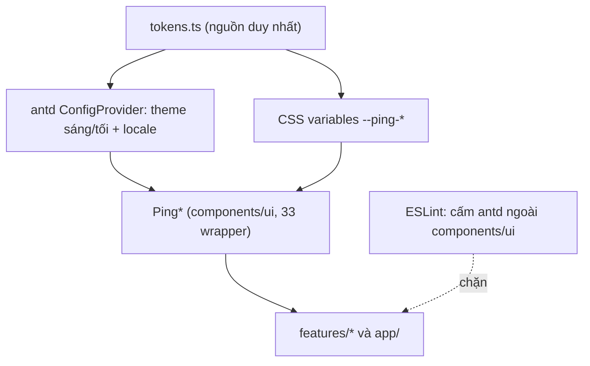

# Case 8 — Frontend: design system token-first, `Ping*` bọc antd, hiệu năng danh sách chat

Trạng thái: hoàn thiện tại T7.2 (2026-11-01). Mức độ: đầy đủ.

## 1. Bối cảnh và vấn đề

v0.1.0 dùng shadcn/Radix + Tailwind, màu khai trong `globals.css`, chỉ desktop
([ADR-0023](../../adr/0023-web-ui-kit-and-tokens.md)). v0.2.0 mở nhiều bề mặt mới — bảng/form quản
trị, cài đặt, drawer AI, shell responsive 375/768/1280 — cần sáng/tối và a11y. Ba rủi ro: mỗi màn
tự style làm lệch token; kéo antd trực tiếp làm rò API và phình bundle; màu antd tự suy có thể
dưới ngưỡng tương phản. Triệu chứng đo được là lỗi thật, không phải false positive: axe bắt chữ
phụ nền sáng chỉ 4,18:1 và nút danger nền tối ~4,4:1 ([T6.9](../evidence/T6.9/README.md),
[T6.7](../evidence/T6.7/README.md)).

## 2. Ràng buộc

ADR-0038 (phạm vi), ADR-0023 (code cũ còn hiệu lực), ngân sách JS tải ban đầu ≤ 450 KB
([ADR-0058](../../adr/0058-bundle-budget-initial-js.md)), CSP không nới `unsafe-inline`
([ADR-0050](../../adr/0050-antd-via-ping-wrappers.md)). Nền: antd `6.6.7`, Next `16.4.2`
([package.json](../../../apps/web/package.json)). Đo trên Chromium/Playwright, chưa có staging.

## 3. Phương án đã cân nhắc

- **Giữ shadcn/Radix:** ít migration nhưng thiếu bảng/form/quản trị dựng sẵn, khó đồng bộ token mới.
- **Dùng antd trực tiếp, không wrapper:** nhanh lúc đầu nhưng rò prop antd khắp app, khó thay thế
  và khó kiểm token/CSP/bundle.
- **Chọn: antd bọc sau `Ping*`**, API riêng, token một nguồn, lint theo tầng (ADR-0050); hướng
  "Expressive Social" ([ADR-0051](../../adr/0051-design-direction.md)).

## 4. Quyết định và thiết kế

`apps/web/src/lib/theme/tokens.ts` là nguồn duy nhất cho màu, spacing bội 4, radius 6/8/12/16,
motion ≤ 200 ms, z-index, typography, rồi ánh xạ sang `ConfigProvider` của antd và CSS variables
`--ping-*` cho component tự dựng ([tokens](../../../apps/web/src/lib/theme/tokens.ts)). Mọi import
`antd`/`@ant-design/*` chỉ nằm trong `components/ui/` (33 `Ping*`); rule bỏ qua thêm `lib/theme`,
`providers` và 5 file layout trong allowlist `useParams`, nhưng quét thực tế không file layout nào
import antd. `features/*` và `app/` chỉ dùng `Ping*`. Mỗi wrapper tự định nghĩa
props (`PingButton` nhận `variant`/`size`/`loading`/`icon`/`block`, không nhận `type`/`ghost`/
`danger` của antd), có `forwardRef`, `data-testid`, đủ trạng thái, ARIA, chỉ token. Nhờ vậy đổi
ruột một wrapper (ví dụ bỏ antd khỏi `PingTooltip`) không phải sửa nơi dùng. Trang kiểm kê
`/dev/ui` là dev-only (`notFound()` ở production).

## 5. Bằng chứng

- **Import antd ngoài `components/ui/` = 0** (quét toàn `apps/web/src`; rule
  `no-restricted-imports` với `group: ['antd','antd/*']` chặn, allowlist cấu hình cho `lib/theme`,
  `providers` và vài file layout) ([eslint.config.mjs](../../../apps/web/eslint.config.mjs), ADR-0050).
- **Bundle trước/sau antd:** v0.1.0 là **389,2 KB** gzip; sau khi thêm antd (T0.7) là **525,8 KB**
  (31 chunk), tức **+136,6 KB (~+35%)** — cả hai theo phép đo cũ "cộng mọi chunk" nên phải nâng
  trần 450 → 550 KB ([T0.7](../evidence/T0.7/README.md), base `761005c`). Từ ADR-0058 đo đúng **JS
  tải ban đầu**: **248,2 KB** gzip / 8 chunk, 74 chunk tải lười 791,4 KB, tổng tham khảo 1039,5 KB
  ([T6.10](../evidence/T6.10/README.md), base `5819507`). Hai thang không so trực tiếp.
- **Lighthouse local trên build production:** performance **57 và 66** ở hai lượt (median dùng cho
  assertion), LCP **6,2–6,6 s**, TBT 840/460 ms, **CLS 0**, accessibility **100**, best-practices 96,
  SEO 100 ([T6.10](../evidence/T6.10/README.md)).
  Đây là laptop dev đang chạy Docker + e2e, không phải staging/CI runner; job Lighthouse trong CI
  vẫn `continue-on-error`.
- **Web Vitals lab (TF.15, production):** landing LCP 1264/268 ms, CLS 0, INP 16 ms; chat LCP
  3556/2948 ms, CLS 0,0289, INP 32 ms ([TF.15](../evidence/TF.15/README.md)). INP/CLS tốt; LCP chat
  chậm hơn ngưỡng 2,5 s vì chờ dữ liệu tin + socket, ghi thành việc tiếp theo (zod ~210 KB là ứng
  viên giảm JS lớn nhất trong treemap).
- **Long task với 10.000 tin: CHƯA ĐO** — TF.6 ghi rõ chưa đo bằng Performance trace
  ([TF.6](../evidence/TF.6/README.md)). Danh sách ảo dùng `@tanstack/react-virtual` (overscan 8,
  estimateSize 56); e2e responsive mới kiểm danh sách 300 tin ([T6.8](../evidence/T6.8/README.md)).
- **a11y và tương phản:** axe **4/4, 0 vi phạm** ([T6.9](../evidence/T6.9/README.md)); đã vá 4 lỗi
  thật gồm focus qua Portal của antd và hai màu antd tự suy, cùng `mutedForeground` 4,18 →
  **4,89:1** ([T6.7](../evidence/T6.7/README.md)). [TF.14](../evidence/TF.14/README.md) đo toàn bộ
  token: 18/18 cặp chữ đạt AA, bắt thêm `darkColors.primary` violet-500 chỉ **4,35:1** → violet-600
  **5,13:1**.
- **Visual regression (TF.13):** 36 baseline (6 màn × sáng/tối × 375/768/1280) trong
  `apps/web/visual`, `threshold 0.3` + 1,5% điểm ảnh; local production **12/12 pass** hai lần liền,
  job CI `visual` là check bắt buộc ([ADR-0074](../../adr/0074-visual-regression-baselines-va-ci.md)).
  Baseline tách theo hệ điều hành; bộ Linux sinh ở lần chạy CI đầu rồi được commit (`13ea987`).

## 6. Trade-off và rủi ro còn lại

- Bọc 33 component là chi phí bảo trì; đổi API công khai buộc sửa mọi nơi dùng.
- antd dùng cssinjs + SSR: nguy cơ FOUC/CSP nonce **chưa xác minh trên staging** (T0.7); theme đọc
  ở client, SSR render `vi` rồi hydrate (TF.12) — chấp nhận vì nội dung chính phụ thuộc đăng nhập.
- Nhiều màu antd tự suy lệch AA (`colorTextDescription`, `Button.colorError`) phải ghim token;
  bài học là ghim sớm thay vì vá từng chỗ.
- Bundle tăng khi thêm bề mặt; feature nào import thẳng vào shell sẽ đội trực tiếp vào 248 KB.
- Hiệu năng thấp trên máy dev (LCP chat 2,9–3,6 s); chưa có long task 10k; visual đã có baseline
  nhưng mới phủ viewport đầu.

## 7. Nếu làm lại / mở rộng tiếp

- Dựng baseline visual trước khi thêm màn và đo diff thật trong CI — lần này làm sau cùng nên
  phải sinh lại toàn bộ 36 ảnh một lượt.
- Đo long task/INP với seed 10.000 tin trên máy tách tải, không so laptop với staging.
- Pin ngay các màu antd tự suy bằng token; kiểm CSP/FOUC trên staging trước khi mở rộng.
- Giữ phép đo bundle theo JS tải ban đầu; đừng cộng mọi chunk — chính phép đo sai đã làm gate đỏ
  giả ở TF.10 (605,1/714,8 KB trong khi JS ban đầu chỉ ~243 KB).

## 8. Nửa frontend

Nửa UI/state của case này: `docs/design/states.md` quy ước loading skeleton, empty có hành động,
error có `requestId`, toast và motion ≤ 200 ms; shell responsive gộp rail + sidebar vào một drawer
dưới 768 ([ADR-0073](../../adr/0073-responsive-shell-375-768-1280.md), T6.8 4/4); i18n vi/en kèm
locale antd/dayjs/zod, đổi ngôn ngữ không reload ([TF.12](../evidence/TF.12/README.md)); TanStack
Query giữ server state, Zustand giữ UI state, component không copy dữ liệu server. TF.11 thêm
drawer AI: stream văn bản thuần fail-closed, chip trích dẫn, `aria-live`
([TF.11](../evidence/TF.11/README.md)). Ba mảnh còn lại của lô này có số đo:
[TF.13](../evidence/TF.13/README.md) 36 baseline + job CI, [TF.14](../evidence/TF.14/README.md)
checklist review thiết kế (chờ OWNER ký), [TF.15](../evidence/TF.15/README.md) Web Vitals và bundle
theo route.
