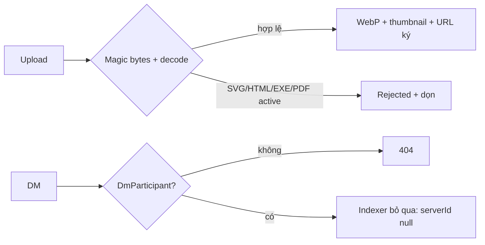

# Case 9 — Tệp tải lên, Markdown không XSS, DM không rò rỉ

Trạng thái: hoàn thiện tại T7.2 (2026-11-01). Mức độ: ngắn (ADR-0038).

## Bối cảnh và ràng buộc

Pha G mở ba bề mặt mới: tệp người dùng tải lên, Markdown trong tin nhắn (đường render nội dung
người dùng lớn nhất), và DM 1:1 nơi quyền không suy ra từ `Member`. Rủi ro: tệp giả MIME/độc hại,
XSS qua link và HTML lồng, IDOR đọc DM hoặc URL tệp đính kèm. Ràng buộc 0 USD (đĩa local, không
S3/antivirus — ADR-0059, ADR-0053), không mã hóa đầu cuối/kiểm duyệt DM (ADR-0056); CSP của Next
còn `'unsafe-inline'` cho script (ADR-0027) nên phòng thủ chính là **không render HTML người dùng**.

## Quyết định

- **Upload:** reserve → PUT → worker kiểm magic bytes, reencode WebP bỏ EXIF, thumbnail; phục vụ
  qua URL ký 60 giây **và** đọc lại quyền từ Postgres ([TG.6](../evidence/TG.6/README.md)); hạn
  link nâng lên 24 giờ từ [ADR-0079](../../adr/0079-tai-tep-dinh-kem-luoi.md), việc đọc lại quyền
  mỗi lần tải không đổi.
- **Markdown:** parser tự viết + AST allowlist, render React trực tiếp, không `innerHTML`
  ([ADR-0054](../../adr/0054-safe-markdown.md)).
- **DM:** mở rộng `Channel` với `serverId` nullable + `DmParticipant` là nguồn quyền; người ngoài
  nhận **404**; indexer bỏ qua `serverId === null` nên DM không vào FTS/vector/RAG
  ([ADR-0070](../../adr/0070-dm-and-user-blocks.md)).

## Bằng chứng

- **Upload:** **9/9 ca tệp độc hại bị chặn** (7 unit + 2 worker e2e; mẫu hai tầng có trùng nội
  dung, không phải 9 mẫu rời), file rejected tải về 404/không gắn được vào tin 400; quota reserve
  nguyên tử 201/400; rời server mất quyền tải ngay (403) dù URL còn hạn; API e2e 272/272
  (commit `c6d6944`, merge `bfad103`).
- **Markdown:** **16/16 payload XSS không thực thi** (`<script>`, ``, `<svg/onload>`,
  `<iframe>`, scheme `javascript:`/`data:`/`vbscript:` kể cả zero-width/RTL, HTML lồng…); e2e qua
  composer khẳng định article không có `<a>/<script>/<iframe>/` (commit `4fa0e20`).
- **DM/IDOR:** e2e **13/13 × 2 lần** — người thứ ba 404 mọi route DM kể cả URL attachment, không
  join được room; block 403 khi gửi mới; DM thứ 11/giờ → 429; bảng IDOR **61 endpoint**, suite 5/5
  (commit `cc18a79`…`036d313`, `057c8c5`).
- **Chưa đo:** thời gian sharp reencode/thumbnail và chi phí lưu trữ/GB; chưa đo tải upload đồng
  thời ngoài ca quota.

## Trade-off và giới hạn

Không antivirus: allowlist + kiểm cấu trúc không chứng minh tệp “sạch”, PDF vẫn cần trình đọc cập
nhật; không preview PDF trong iframe. Đĩa local không có độ bền độc lập. URL ký là bearer
capability chia sẻ được trong 60 giây (24 giờ từ [ADR-0079](../../adr/0079-tai-tep-dinh-kem-luoi.md);
quyền vẫn kiểm lại từ Postgres mỗi lần tải). DM không audit, không E2EE, không tìm kiếm (FTS scope theo
server), người đã đọc trước khi bị chặn vẫn giữ nội dung cũ.

## Nửa frontend

Draft giữ `File`/progress, URL làm mới trước hạn, chặn gửi khi tệp chưa `ready`; `MarkdownText`
memo theo content, spoiler cần state client + nhãn aria vi/en. DM tái dùng `MessagePane` với
`serverId: null` + `DmAbilityProvider`, composer tự tắt theo ability thay vì hard-code 403, banner
`role="status"`, badge rail có nhãn đếm. Bài học phỏng vấn: bề mặt riêng tư mới là **một nguồn
quyền mới** — chặn DM ở indexer chứ không chỉ ở truy vấn, và coi mọi tệp là độc hại cho tới khi
pipeline chứng minh ngược lại.
