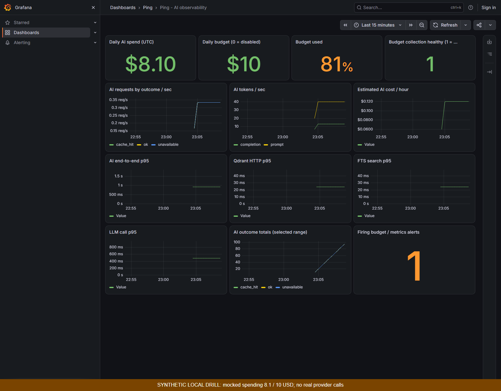
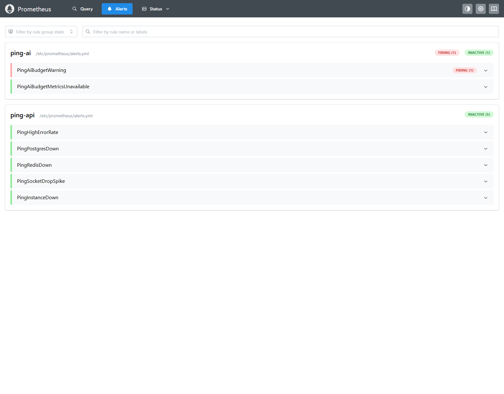

# T5.11 — Metrics AI, dashboard và cảnh báo ngân sách

- Ngày: 2026-10-25.
- Nhánh: `feat/t5.11-ai-observability`, worktree `D:/discord/Ping-t5.11`.
- Commit triển khai: `1ec742d`; base `7f606fe` (TG.1).
- Phạm vi đã được OWNER đồng ý trong phiên: T5.11, làm riêng song song với Reply.
- Trạng thái: hoàn tất kiểm tra local; chưa merge/push, chưa có CI remote cho nhánh này.

## Thay đổi

Thêm `ai_latency_seconds`, `qdrant_latency_seconds`, `search_latency_seconds`, giữ
counter/token/chi phí và `ai_llm_duration_seconds` cũ. Đo cả lỗi và generator hủy;
nhãn hữu hạn, không chứa user, câu hỏi hay ID tài nguyên.

Chi phí ngày lấy từ `AiUsage` trong Postgres tại mỗi scrape (UTC), kèm ngân sách cấu
hình và sức khỏe collector. Hai gauge đợi chung một query để không lệch một chu kỳ.
Khi DB lỗi: chi phí NaN, health 0. Rule dùng MAX cho tổng toàn DB giữa nhiều replica;
không cộng trùng, không dùng counter vòng đời process thay ngân sách ngày.

Cảnh báo vượt 80% duy trì 2 phút; budget 0 tắt cảnh báo, có cảnh báo collector riêng.
Stack Prometheus 3.15.0 + Grafana OSS 13.2.4 local chỉ publish loopback; datasource
và dashboard provision từ file. CI chạy cả cú pháp và hành vi rule bằng promtool.
Quyết định: [ADR-0061](../../../adr/0061-ai-observability.md).

## Kiểm chứng

| Kiểm tra                | Kết quả                                                                                      | Bằng chứng                                                                       |
| ----------------------- | -------------------------------------------------------------------------------------------- | -------------------------------------------------------------------------------- |
| Test trước triển khai   | 7 test đỏ vì thiếu metric/observer                                                           | [test-red.log](test-red.log)                                                     |
| Test mới sau triển khai | 36/36 xanh ở 4 file liên quan                                                                | [test-green.log](test-green.log)                                                 |
| Unit toàn repo          | API 149, web 178, shared 29; workflow 27 xanh                                                | [test.log](test.log)                                                             |
| API e2e thật            | 190/190, 29 file; có test scrape tổng chi phí từ Postgres                                    | [api-e2e.log](api-e2e.log)                                                       |
| Lint/typecheck/build    | Xanh                                                                                         | [lint](lint.log), [typecheck](typecheck.log), [build](build.log)                 |
| Alert trước rule        | Đỏ do chưa có cảnh báo                                                                       | [alerts-red.log](alerts-red.log)                                                 |
| Alert rules             | 7 kịch bản xanh, bao gồm >80%, đúng 80%, budget 0, DB lỗi, replica, đổi ngày, collector down | [alert-rules.log](alert-rules.log)                                               |
| CI workflow             | actionlint xanh                                                                              | [actionlint.log](actionlint.log)                                                 |
| Trình duyệt thật        | Dashboard có dữ liệu, alert firing, không page error                                         | [browser-check.json](browser-check.json), [alert-firing.json](alert-firing.json) |
| Bundle                  | 243,9 KB gzip ban đầu, đạt check                                                             | Kiểm lại bằng lệnh dưới                                                          |
| Docs/format             | Xanh sau khi hoàn tất evidence                                                               | Kiểm lại bằng lệnh dưới                                                          |

Môi trường: Windows, Node 24.22.0, pnpm 10.26.0, Docker 28.5.1. API e2e dùng
Postgres DB `ping_t511` và Redis DB 11 riêng; chỉ migrate DB mới, không thay schema
hay xóa dữ liệu dev/Reply. Raw HTTP request logs được bỏ khỏi evidence, giữ kết quả
Vitest. Không sửa migration, không thêm dependency ứng dụng, không gọi LLM trả phí.

## Ảnh drill — dữ liệu mô phỏng





Nguồn scrape là `MetricsService` thật nhưng adapter DB/Redis giả, chi phí cố định
8,1/10 USD và traffic mô phỏng. Ảnh chỉ chứng minh đường metrics → Prometheus →
Grafana và rule firing; không chứng minh chi phí provider thật hay hiệu năng production.
Việc đọc tổng từ Postgres thật được kiểm riêng bằng API e2e.

## Chạy lại

Xem [hướng dẫn stack và drill](../../../../ops/monitoring/README.md).
Từ gốc repo:

```powershell
pnpm --filter api exec vitest run src/infra/metrics/metrics.service.spec.ts src/modules/messages/search.service.spec.ts src/modules/ai/qdrant-vector-store.spec.ts src/modules/ai/ask/ask.service.spec.ts
pnpm lint
pnpm typecheck
pnpm test
pnpm build
pnpm --filter web check:bundle
pnpm docs:check
pnpm format:check
```

API e2e: đặt `DATABASE_URL` tới DB test đã migrate và `E2E_REDIS_URL` tới Redis DB
riêng, rồi `pnpm --filter api test:e2e`. Không hướng suite có thao tác reset Redis
vào DB đang được agent hoặc ứng dụng khác sử dụng.

Chụp lại sau khi fixture và stack chạy hơn 2 phút:

```powershell
node apps/web/scripts/capture-ai-monitoring.mjs
```

## Giới hạn và rollback

Cảnh báo local đã firing, chưa cấu hình người nhận Alertmanager/email/Slack hay staging.
Không chạy full web ứng dụng e2e vì không sửa giao diện ứng dụng; dashboard được kiểm
bằng Chromium thật. Một lỗi ban đầu trong helper chụp ảnh là chờ `networkidle` trên
Prometheus có request nền; đã đổi sang `domcontentloaded` và đợi tên rule.

Mỗi scrape thêm một aggregate query/instance, có timeout hiện hữu của Prisma. Ngân
sách/giá phải cấu hình nhất quán giữa replica. Free tier có giá 0 thì cost bằng 0.
Cạnh tranh vượt trần nhẹ của ADR-0047 giữ nguyên. Tắt stack monitoring và bỏ
`METRICS_PORT` để rollback giám sát; không cần rollback DB.

## Local merge into main

OWNER approved the local merge on 2026-10-25. Main base: `ceab294`.
The only conflict was `status.md`: kept main’s latest TG.1/CI record and added
the T5.11 row. Application code merged without conflicts. This merge does not
push to the remote; remote CI for T5.11 remains pending.
