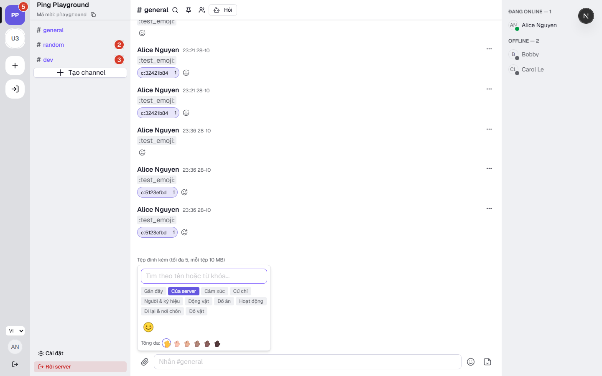
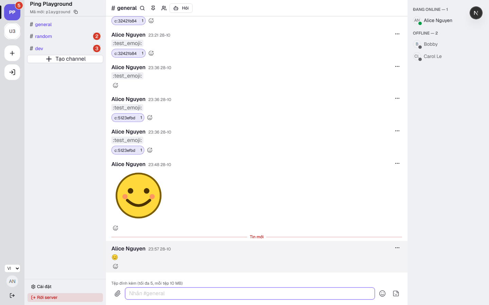
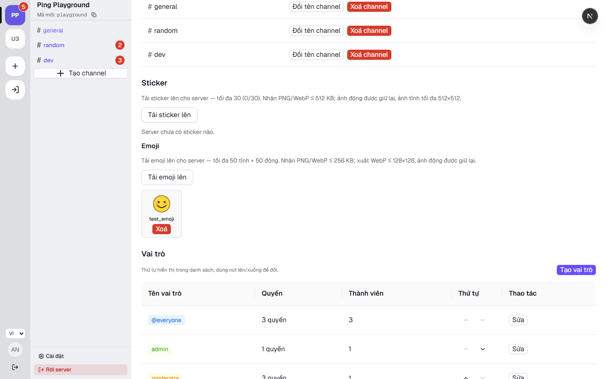

# Evidence TG.24 — Emoji tùy chỉnh theo server

- Ngày: 2026-10-28 (Asia/Saigon); nhánh `feat/tg24-custom-emoji`; base `e6d7c27` (main sau TG.22).
- Thiết kế: [ADR-0068](../../../adr/0068-custom-server-emoji.md) — OWNER duyệt trong phiên
  2026-10-28, triển khai trọn trong phiên.

## Đã giao

**Shared + migration** (commit `0064313` + `feat(api)` migration):

- Model `CustomEmoji {id, serverId, name [a-z0-9_]{2,32}, animated, attachmentId unique,
createdBy (cột trần), deletedAt, createdAt}` index `(serverId, deletedAt, createdAt)`;
  migration expand `20261028151128_tg24_custom_emoji`, `migrate status` in sync.
- Scope upload `'customEmoji'` — tệp gốc ≤ `EMOJI_FILE_BYTES = 256 KiB`, bắt buộc serverId;
  mã `EMOJI_LIMIT_REACHED`; `Limits.EMOJIS_STATIC_PER_SERVER = 50` /
  `EMOJIS_ANIMATED_PER_SERVER = 50`; schema `custom-emoji.ts` (createCustomEmojiSchema,
  CustomEmojiDto, `customEmojiToken` → `:ten:<id>`, `CUSTOM_EMOJI_TOKEN_PATTERN`,
  `customEmojiReactionToken` → `c:<id>`); `reactionTokenSchema` trong emoji.ts nhận unicode
  allowlist HOẶC token `c:<uuid>`; event `expressions.updated {serverId}` (ServerEvents +
  payload + manifest socket).

**API** (commit `ea4ba14`):

- `POST /servers/:serverId/emos`… — chuẩn tên route: `POST /servers/:serverId/emojis`
  (ability `create Sticker` = MANAGE_EXPRESSIONS tái dùng): advisory lock `emoji-server:<id>`,
  claim tệp (pattern claim TG.7 — một tệp một emoji), **trần 50 tĩnh + 50 động** theo bucket
  (vượt → 400 `EMOJI_LIMIT_REACHED` kèm `details {bucket}`), idempotent theo attachmentId
  (retry trả emoji cũ cùng server). Cờ `animated` suy tại claim bằng sharp đọc metadata tệp
  `.ready` (`pages > 1`) — không cần cột mới, tệp ≤256 KiB nên đọc rất rẻ.
- `GET /servers/:serverId/emojis` (ability `view Sticker` — mọi member); `DELETE
/emojis/:emojiId` (guard tra server qua `:emojiId` — nhánh mới AbilityGuard; soft-delete +
  audit `EMOJI_DELETE` + phát hành tệp `status 'deleting'`).
- Kiểm định tham số hóa: `validateImageFile(bytes, {maxBytes, maxEdge})` dùng chung —
  `validateStickerFile` (512 KiB/512px) và `validateCustomEmojiFile` (256 KiB/**128×128**)
  chỉ là wrapper; worker thêm nhánh scope `customEmoji` (validate + dọn khi server mất).
- **Gửi tin**: service trích token bằng `CUSTOM_EMOJI_TOKEN_PATTERN` — token của emoji CÒN
  SỐNG nhưng thuộc server khác → 400 (IDOR); token đã xóa/không tồn tại → vẫn 201 (client
  render placeholder).
- **Reaction**: `parseReactionEmoji` đổi sang `reactionTokenSchema`; token `c:<id>` được kiểm
  trong transaction (emoji sống + đúng server của tin, sai → `REACTION_EMOJI_INVALID`).
- Event `expressions.updated {serverId}` phát room server sau tạo/xóa emoji VÀ sticker (gộp
  một event cho cả biểu cảm — sticker.service phát thêm).

**Web** (commit `2f12ae9`):

- `features/emojis/`: api/hooks (`useEmojis` staleTime 5 phút, `useEmojiMap` Map id→DTO,
  `useEmojiEvents` nghe `expressions.updated` invalidate emojis + stickers — hai tab tự đồng
  bộ), `emoji-utils.ts` thuần (tìm không dấu `foldVi`, khoảng trắng coi như `_`; gợi ý tên từ
  tên tệp — fold dấu trước) + test.
- Parser TG.4: node `{type:'customEmoji', id, name}` — nhóm regex token đặt TRƯỚC nhóm
  shortcode thường (cùng bắt đầu `:`); token thiếu uuid không bị nuốt; token trong inline code
  giữ nguyên văn. Render: `MarkdownText` nhận `serverId` (truyền xuyên block/inline/spoiler),
  resolve qua `useEmojiMap` → `` inline 20px (ưu tiên `previewUrl`); thiếu/đã xóa → chip
  mờ `:name:` (`data-testid="custom-emoji-placeholder"`); bigEmoji không áp dụng.
- EmojiPicker (TG.23): tab "Của server" (ảnh 32px, tìm không dấu, empty state riêng); gợi ý
  composer gộp custom vào cuối danh sách (ảnh nhỏ + `:name:`); reaction: pill token `c:`
  resolve ảnh 16px (fallback `c:<8 ký tự cuối>`), picker reaction chọn custom → token.
- Quản trị: khối Emoji trong mục Biểu cảm (upload scope customEmoji, tên validate
  `[a-z0-9_]`, xóa Popconfirm, grid giữ ảnh động); i18n vi/en đủ key; audit UI có nhãn
  `EMOJI_DELETE`.

## Kiểm chứng hiện tại

| Hạng mục                          | Kết quả                                                                                                                                                        |
| --------------------------------- | -------------------------------------------------------------------------------------------------------------------------------------------------------------- |
| Shared unit                       | **54/54** (thêm: schema tên `[a-z0-9_]`, token `:ten:<id>` + pattern trích — token thiếu id không bị nuốt, reaction token nhận unicode + `c:<uuid>` chặn junk) |
| API unit                          | **209/209** (file-validation giữ nguyên hành vi sau tham số hóa)                                                                                               |
| Web unit                          | **213/213** (thêm: emoji-utils 9 ca; markdown 4 ca — token chuẩn, tên chữ số, uuid sai hình thức fallback, token trong code block giữ nguyên)                  |
| API e2e                           | stickers + attachments 19/19 pass trên nhánh; **emojis e2e + IDOR 45 route — xem phần e2e dưới**                                                               |
| Web e2e                           | **emoji-custom.spec — xem phần e2e dưới**                                                                                                                      |
| Lint / format / typecheck / build | pass toàn repo; `check:bundle` JS tải ban đầu **246.4 KB ≤ 450 KB**                                                                                            |
| Migration                         | `20261028151128_tg24_custom_emoji` apply, `migrate status` in sync                                                                                             |

## Phần e2e

| Bộ                     | Kết quả                                                                                                                                                                                                                                                                                                                                                                                                                                                                                                                                                                                         |
| ---------------------- | ----------------------------------------------------------------------------------------------------------------------------------------------------------------------------------------------------------------------------------------------------------------------------------------------------------------------------------------------------------------------------------------------------------------------------------------------------------------------------------------------------------------------------------------------------------------------------------------------- |
| API e2e `emojis`       | **10/10 pass**: upload→claim→list, quyền member/outsider, tĩnh 200×200 bị rejected, trần tĩnh 50 (chèn 49 + 2 API — thứ 51 → 400 `EMOJI_LIMIT_REACHED` bucket static, xóa mềm giải phóng), trần động 50 (WebP động thật — cờ `animated` suy từ metadata nên bucket động buộc fixture động), token tin (sống đúng server 201 / server khác 400 / đã xóa 201 / bịa 201), reaction `c:<id>` (đúng server OK, server khác + đã xóa → 400 `REACTION_EMOJI_INVALID`, `👍` vẫn hoạt động), xóa (member 403, manager OK, tin cũ giữ nguyên token, 404 lần 2), audit `EMOJI_DELETE`, idempotent theo tệp |
| API e2e IDOR           | `ID_ROUTES` 42 → **45** (3 route emoji), thêm 2 đòn tấn công (outsider DELETE emoji, lowPriv POST emojis) — pass                                                                                                                                                                                                                                                                                                                                                                                                                                                                                |
| Web e2e `emoji-custom` | **3/3 pass × 2 lần liên tiếp** (1,6 phút): (a) upload quản trị qua pipeline thật → picker bob thấy qua event → chèn token qua picker (composer value khớp `:test_emoji:<id>`) → gửi → render img, bob nhận realtime; (b) gợi ý `:test` gộp custom (Enter sau khi điều hướng ArrowDown) + reaction pill ảnh `c:<id>`; (c) xóa → tab khác (không reload) đổi placeholder `:test_emoji:` + pill degrade `c:<8 ký tự>` không crash                                                                                                                                                                  |
| Full API e2e           | **298/298 pass (36 file, 155 s)** — trước TG.24: 288/288 (35 file)                                                                                                                                                                                                                                                                                                                                                                                                                                                                                                                              |
| Full web e2e           | **45 pass / 1 skip (18,8 phút), KHÔNG fail nào** — trước TG.24: 42 pass + 3 flake                                                                                                                                                                                                                                                                                                                                                                                                                                                                                                               |
| Hồi quy                | stickers + attachments e2e 19/19 pass trên nhánh                                                                                                                                                                                                                                                                                                                                                                                                                                                                                                                                                |

Học được từ e2e: schema tên emoji `[a-z0-9_]{2,32}` KHÔNG nhận gạch ngang (cố tình — tên có `-`
sẽ làm token `:ten:<id>` không khớp pattern trích); cờ `animated` suy từ metadata nên bucket
động buộc fixture WebP động thật (đã có sẵn pattern VP8X/ANMF từ file-validation.spec).

## Ảnh giao diện (dev stack, tài khoản alice, server seed "Ping Playground")

| Ảnh                           | Nội dung                                                                                                                   |
| ----------------------------- | -------------------------------------------------------------------------------------------------------------------------- |
|    | Emoji picker, tab **"Của server"** đang chọn: emoji tùy chỉnh `test_emoji` lấy ảnh qua URL hồ sơ 30 ngày                   |
|  | Tin gửi bằng token `:test_emoji:<id>` render **ảnh inline** trong #general (các tin cũ hơn là placeholder sau khi e2e xóa) |
|      | Cài đặt server — khối **Emoji** (trần "50 tĩnh + 50 động", thẻ `test_emoji` với nút Xoá Popconfirm)                        |

## Lưu ý vận hành

- DB dev có hàng `Attachment` scope avatar `ready` mồ côi từ phiên bị ngắt trước đó khiến
  worker `runOnce()` đói hàng (orphan rule bắt cả hàng ready cũ, `LIMIT 1` bị chiếm mãi) — đã
  set `status='deleted'` đúng vòng đời để e2e chạy được. **Nợ nhỏ đáng cân nhắc** (ngoài phạm vi
  TG.24): nhánh orphan của worker nên có điều kiện `boundAt`/trạng thái để không soát vé hàng
  ready đã claim lâu ngày; ghi tạm vào phần này, cân nhắc đưa vào tech-debt.
